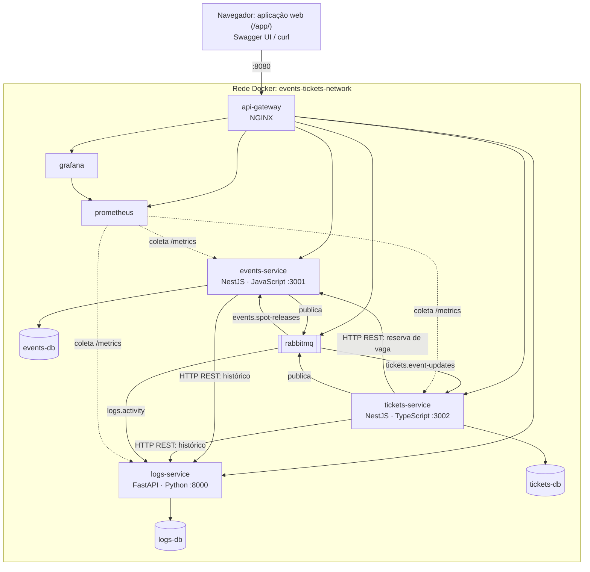

# events-tickets-ms

Plataforma distribuída de gestão de eventos e emissão unificada de inscrições e ingressos, com registro de atividades, desenvolvida como Trabalho Prático da disciplina de Sistemas Distribuídos (UFMS).

O sistema é genérico: atende de simpósios acadêmicos e workshops online a shows, corridas de rua e campeonatos de e-sports. Inscrição e ingresso são a mesma entidade: ao se inscrever, o participante recebe um ingresso digital com código único e controle de presença (check-in). Cada mudança em eventos e ingressos fica registrada no serviço de logs, que permite consultar o histórico e fazer a triagem dos registros.

**Autor:** [Igor-Lazarin-Oliani](https://github.com/Igor-Lazarin-Oliani)

**Início rápido** (requer apenas Docker):

```sh
git clone https://github.com/Igor-Lazarin-Oliani/events-tickets-ms.git
cd events-tickets-ms
docker compose up --build -d
```

Depois, abra a [aplicação web](http://localhost:8080/), que mostra cada chamada atravessando os componentes, ou o Swagger de [eventos](http://localhost:8080/docs/events), de [ingressos](http://localhost:8080/docs/tickets) e de [logs](http://localhost:8080/docs/logs), ou siga o [roteiro de demonstração](#roteiro-de-demonstração).

## Requisitos atendidos

| Requisito | Como é atendido |
|---|---|
| Heterogeneidade e CRUD | `events-service` em JavaScript/NestJS (CRUD de eventos), `tickets-service` em TypeScript/NestJS (CRUD de ingressos) e `logs-service` em Python/FastAPI (CRUD de registros de atividade) |
| Banco por serviço | `events-db`, `tickets-db` e `logs-db`, três instâncias PostgreSQL separadas |
| Conteinerização | Um `Dockerfile` por serviço e `docker-compose.yml` orquestrando os 10 contêineres na rede `events-tickets-network` |
| API Gateway | NGINX como única porta de entrada, com lista de rotas permitidas |
| Comunicação entre serviços | JSON por HTTP REST síncrono (reserva de vaga e histórico) e pelo RabbitMQ (devolução de vagas, cancelamento em cascata e registro de atividades) |
| Aplicação web | Página em `/app/`, servida pelo próprio gateway: CRUD de eventos, ingressos e registros, com o diagrama dos contêineres e o rastro de cada chamada |
| Documentação interativa | Swagger UI dos três serviços, acessível pelo gateway |
| Observabilidade | Prometheus coletando as métricas dos três serviços, painéis no Grafana e logs estruturados correlacionados entre gateway e serviços |
| Mensageria assíncrona (bônus) | RabbitMQ com padrão outbox nos dois sentidos entre eventos e ingressos, e de ambos para o `logs-service` |

## Arquitetura

O ambiente tem um API Gateway como única porta de entrada, três microsserviços em tecnologias diferentes, cada um com seu próprio banco de dados, mensageria assíncrona com RabbitMQ e uma camada de observabilidade com Prometheus e Grafana.



| Componente | Tecnologia | Responsabilidade |
|---|---|---|
| `api-gateway` | NGINX | Entrada única e roteamento para os serviços |
| `events-service` | Node.js 20, NestJS em JavaScript (Babel), TypeORM | Eventos e vagas: reserva idempotente e devolução |
| `tickets-service` | Node.js 20, NestJS em TypeScript, TypeORM | Inscrições, ingressos e check-in |
| `logs-service` | Python 3.11, FastAPI, SQLAlchemy 2, Pydantic v2 | Registro de atividades: histórico e triagem |
| `events-db` | PostgreSQL 16 | Banco exclusivo do `events-service` |
| `tickets-db` | PostgreSQL 16 | Banco exclusivo do `tickets-service` |
| `logs-db` | PostgreSQL 16 | Banco exclusivo do `logs-service` |
| `rabbitmq` | RabbitMQ | Mensageria assíncrona: 3 exchanges e 3 filas |
| `prometheus` | Prometheus | Coleta das métricas dos serviços |
| `grafana` | Grafana | Painéis de telemetria |

### Por que essa divisão

**Eventos e ingressos em serviços separados.** O `events-service` é dono dos eventos e da verdade sobre as vagas; o `tickets-service`, dos ingressos e dos participantes. Cada um evolui, escala e falha de forma independente. A regra mais importante do domínio, nunca vender mais ingressos que vagas, atravessa os dois bancos sem perder a consistência:

- a **reserva** é síncrona, porque o cliente precisa saber na hora se conseguiu o ingresso, e idempotente: o `tickets-service` gera o `id` do ingresso antes e o usa como chave da reserva;
- se o ingresso não puder ser salvo depois da reserva, ou se o `events-service` não responder, o `tickets-service` pede a **devolução** da vaga (compensação);
- a devolução, ao cancelar um ingresso, vai pelo RabbitMQ, gravada junto com o cancelamento: ela não precisa de resposta, precisa acontecer;
- cancelar um evento avisa o `tickets-service` pelo RabbitMQ, que cancela os ingressos ativos.

**O registro de atividades fica separado** porque tem outra natureza: só acrescenta dados, tem outra retenção e não pode impedir uma venda se cair. Recebe as atividades do `events-service` e do `tickets-service` de forma assíncrona, tem banco próprio e é consultado por HTTP só para montar o histórico.

O `logs-service` é um serviço de domínio (auditoria do que aconteceu com eventos e ingressos). A observabilidade técnica, com métricas e painéis, fica com Prometheus e Grafana.

## Principais fluxos

**Emissão de ingresso (`POST /tickets`):** o `tickets-service` confere se o participante já está inscrito e se o evento já foi encerrado, gera o `id` do ingresso e pede a vaga ao `events-service` por HTTP (`PATCH /events/{id}/reserve-spot`, rota interna). O `events-service` confere o evento, reserva com um `UPDATE` condicional e registra a reserva pelo `ticket_id`, numa transação que também grava a atividade `event.spot_reserved`. Com a vaga reservada, o `tickets-service` salva o ingresso e grava `ticket.issued` numa transação local. Se o salvamento falhar, a vaga é devolvida; se o `events-service` não responder, a resposta é `503`, e uma eventual reserva é devolvida.

**Cancelamento (`DELETE /tickets/{id}`):** o ingresso passa para `CANCELLED`, o registro é mantido, e o pedido de devolução da vaga é gravado na mesma transação. O `events-service` o consome e devolve a vaga uma única vez; o evento volta a `PUBLISHED` cerca de 1 s depois.

**Cancelamento ou remoção de evento:** o `events-service` responde na hora e avisa o `tickets-service` pelo RabbitMQ, que cancela os ingressos ativos cerca de 1 s depois. Os ingressos mantêm uma cópia dos dados do evento (`event_snapshot`).

**Registro de atividades (assíncrono):** cada mudança grava as mensagens na tabela `outbox_messages` do próprio serviço, na mesma transação (padrão *outbox*). A cada segundo, o `events-service` e o `tickets-service` publicam as pendentes no RabbitMQ em lotes de até 50, e o `logs-service` grava as atividades. Se o broker ou um consumidor estiverem fora do ar, as mensagens aguardam e são entregues quando eles voltarem.

**Histórico (síncrono):** `GET /events/{id}/history` (no `events-service`) e `GET /tickets/{id}/history` (no `tickets-service`) consultam o `logs-service` por HTTP e devolvem as atividades em ordem cronológica, em páginas de até 500, com o `total`. Com o `logs-service` fora do ar, só essas rotas respondem `503`.

**Regras principais:**

- A reserva de vagas é atômica, e requisições simultâneas não vendem mais vagas do que existem.
- Reserva e devolução são idempotentes pelo `id` do ingresso: repetir não reserva nem devolve outra vaga.
- Só é possível se inscrever em evento que existe e ainda não terminou: com o `end_at` no passado, a inscrição é recusada.
- O evento passa para `SOLD_OUT` ao esgotar e volta para `PUBLISHED` quando uma vaga é devolvida.
- Cada documento pode ter apenas uma inscrição ativa por evento.
- Ao alterar a capacidade de um evento, as vagas já ocupadas são preservadas.
- Um evento cancelado não pode ser reaberto.
- Um registro de atividade não pode ser reescrito: só a triagem (`status` e `notes`) muda, e excluir significa arquivar.

## Endpoints

Todas as rotas públicas são acessadas pelo gateway, em `http://localhost:8080`.

### `events-service`

| Método e rota | Descrição |
|---|---|
| `POST /events` | Cria um evento |
| `GET /events` | Lista os eventos (filtros: `category`, `status`; paginação com `limit` e `offset`) |
| `GET /events/{id}` | Busca um evento |
| `PUT /events/{id}` | Atualiza um evento; `CANCELLED` faz o `tickets-service` cancelar os ingressos ativos |
| `DELETE /events/{id}` | Remove o evento; o `tickets-service` cancela os ingressos ativos |
| `GET /events/{id}/history` | Histórico do evento, vindo do `logs-service` (paginação com `limit` e `offset`) |

A rota `PATCH /events/{id}/reserve-spot` é interna, chamada só pelo `tickets-service`, e não é exposta pelo gateway. Ela aparece no Swagger de eventos como integração.

### `tickets-service`

| Método e rota | Descrição |
|---|---|
| `POST /tickets` | Realiza a inscrição e emite o ingresso, reservando a vaga no `events-service` |
| `GET /tickets` | Lista os ingressos (filtros: `event_id`, `participant_email`, `status`; paginação com `limit` e `offset`) |
| `GET /tickets/{id}` | Consulta por UUID ou `ticket_code` |
| `PUT /tickets/{id}` | Atualiza o ingresso ou realiza o check-in |
| `DELETE /tickets/{id}` | Cancela o ingresso; a vaga volta ao evento cerca de 1 s depois |
| `GET /tickets/{id}/history` | Histórico do ingresso, vindo do `logs-service` (paginação com `limit` e `offset`) |

### `logs-service`

| Método e rota | Descrição |
|---|---|
| `POST /logs` | Cria um registro manual, como uma ocorrência anotada pela organização |
| `GET /logs` | Lista os registros (filtros: `entity_type`, `entity_id`, `action`, `level`, `status`, `source`, `correlation_id`, `include_archived`; ordem e paginação com `order`, `limit` e `offset`) |
| `GET /logs/{id}` | Busca um registro, mesmo arquivado |
| `PUT /logs/{id}` | Atualiza a triagem: `status` (`NEW`, `REVIEWED`, `RESOLVED`) e `notes` |
| `DELETE /logs/{id}` | Arquiva o registro |

As listagens (`GET /events`, `GET /tickets` e `GET /logs`) são paginadas: `limit` vai de 1 a 500 (padrão 100), `offset` pula itens, e o cabeçalho `X-Total-Count` traz o total que atende aos filtros. Os históricos usam `limit` padrão 500 e informam o total no campo `total`.

### Documentação e telemetria

Disponíveis pelo gateway, com o ambiente em execução. A [aplicação web](http://localhost:8080/) (`/app/`) reúne tudo em uma página.

| Recurso | Eventos | Ingressos | Logs |
|---|---|---|---|
| Swagger UI | http://localhost:8080/docs/events | http://localhost:8080/docs/tickets | http://localhost:8080/docs/logs |
| Métricas Prometheus | http://localhost:8080/metrics/events | http://localhost:8080/metrics/tickets | http://localhost:8080/metrics/logs |
| Saúde | http://localhost:8080/health/events | http://localhost:8080/health/tickets | http://localhost:8080/health/logs |

| Ferramenta | Endereço | Acesso |
|---|---|---|
| Painel Grafana | http://localhost:8080/grafana/ | Abre sem login, somente leitura. Para editar: `admin` / `admin` |
| Prometheus (alvos da coleta) | http://localhost:8080/prometheus/targets | Sem login |
| RabbitMQ (filas e mensagens) | http://localhost:8080/rabbitmq/ | `events_tickets` / `events_tickets_pass` |

Nos três Swaggers, `/health` e `/metrics` aparecem documentadas como rotas internas; pelo gateway, use os endereços da tabela acima.

Os logs dos contêineres são estruturados, com marcadores como `[GATEWAY]`, `[TICKET ISSUED]`, `[EVENT SPOT RESERVED]`, `[EVENT SPOT RELEASED]`, `[COMPENSATION QUEUED]`, `[TICKETS CANCELLED BY EVENT]`, `[ACTIVITY MESSAGE PUBLISHED]`, `[ACTIVITY LOGGED]`, `[HTTP SYNC REQUEST]` e `[TELEMETRY]`. O cabeçalho `X-Correlation-Id` liga os logs do gateway, dos três serviços e as mensagens do RabbitMQ em uma mesma operação.

## Como executar

O único pré-requisito é o Docker com o Docker Compose. A porta 8080 precisa estar livre.

```sh
# obter o código
git clone https://github.com/Igor-Lazarin-Oliani/events-tickets-ms.git
cd events-tickets-ms

# construir as imagens e subir os contêineres
docker compose up --build -d

# conferir: todos devem aparecer como "healthy"
docker compose ps

# acompanhar os logs
docker compose logs -f api-gateway events-service tickets-service logs-service
```

Para encerrar:

```sh
docker compose down      # mantém os dados
docker compose down -v   # apaga também os dados
```

Já rodou uma versão anterior deste projeto na mesma máquina? Rode `docker compose down -v` antes de subir: os bancos mudaram de esquema, e o projeto não usa migrações.

Os contêineres usam `restart: unless-stopped`: se um processo cair, o Docker o reinicia sozinho. Um `docker compose stop` continua valendo, e o contêiner fica parado até você subi-lo de novo. Contêineres que ficarem no ar voltam quando o Docker reiniciar, por isso encerre com `docker compose down` ao terminar.

Nenhum serviço depende de outro para subir. O `api-gateway` e o `prometheus` esperam o `events-service` e o `tickets-service`, mas não o `logs-service`: se ele demorar ou falhar, a venda funciona normalmente, e só as rotas de logs e de histórico respondem `503` até ele ficar `healthy`.

Só o `api-gateway` publica porta no host. Serviços e bancos ficam acessíveis apenas na rede interna; para inspecionar um banco, use, por exemplo:

```sh
docker compose exec events-db psql -U events_user -d events_db -c 'select title, available_spots, status from events;'
docker compose exec events-db psql -U events_user -d events_db -c 'select ticket_id, status from spot_reservations;'
docker compose exec tickets-db psql -U tickets_user -d tickets_db -c 'select ticket_code, status from tickets;'
docker compose exec logs-db psql -U logs_user -d logs_db -c 'select occurred_at, source, action, level from activity_logs order by occurred_at;'
```

As credenciais estão no `docker-compose.yml` e são exclusivas do ambiente local deste trabalho.

## Roteiro de demonstração

O roteiro parte de um ambiente no ar. Pode ser feito pela aplicação web, pelo Swagger UI ou pelos comandos `curl` mais abaixo.

### Pela aplicação web

Abra http://localhost:8080/. À esquerda fica a aplicação; à direita, o diagrama dos 10 contêineres, os contadores do Prometheus e das filas, e o rastro de cada operação. Toda chamada leva um `X-Correlation-Id` com prefixo `ui-`, e a parte assíncrona só é marcada como concluída quando os registros com esse identificador chegam ao `logs-service`.

| # | Ação | O que observar |
|---|---|---|
| 1 | **+ Novo evento**, com capacidade 5 | Navegador → gateway → `events-service` → `events-db`; depois, `event.created` chega ao `logs-service` pelo RabbitMQ |
| 2 | **Inscrever** um participante | `201`, com o passo `tickets-service → events-service` (reserva por REST) no rastro; `ticket.issued` e `event.spot_reserved` chegam ao `logs-service` |
| 3 | **⚡ Concorrência** com 20 inscrições | Só 4 recebem `201`, as outras 16 recebem `409 Event is sold out`, e o evento vai a `SOLD_OUT`: nenhuma vaga vendida além da capacidade |
| 4 | **Check-in** e **Cancelar** em ingressos | A devolução da vaga passa pelo RabbitMQ até o `events-service`; o evento volta a `PUBLISHED` cerca de 1 s depois |
| 5 | **Histórico** do evento | A linha verde-azulada mostra o `events-service` consultando o `logs-service` por HTTP REST |
| 6 | **Cancelar evento** com ingressos ativos | O aviso vai do `events-service` ao `tickets-service` pelo RabbitMQ, e os ingressos aparecem cancelados |
| 7 | Aba **Registro de atividades** | Triagem (`status` e notas), arquivamento e registro manual de ocorrência |
| 8 | **Experimentos de falha** | Comandos para derrubar o `logs-service`, o `events-service` ou o RabbitMQ e ver as mensagens esperando na fila ou na outbox |

O botão **grep** de cada operação copia o comando que mostra a mesma operação nos logs do gateway e dos três serviços.

### Pelo Swagger UI

| # | Onde | Ação | Resultado esperado |
|---|---|---|---|
| 1 | Eventos, `POST /events` | Executar o exemplo, que já tem `max_capacity: 2`, e copiar o `id` | `201`, `available_spots: 2`, `PUBLISHED` |
| 2 | Ingressos, `POST /tickets` | Emitir 2 ingressos com esse `event_id` e `participant_document` diferentes | `201` nos dois, com `ticket_code` no formato `EVT-2026-XXXXXX` |
| 3 | Eventos, `GET /events/{id}` | Consultar o evento | `available_spots: 0`, `SOLD_OUT` |
| 4 | Ingressos, `POST /tickets` | Tentar um 3º ingresso, com outro documento | `409 Event is sold out` |
| 5 | Ingressos, `PUT /tickets/{id}` | Enviar `{"status": "CHECKED_IN"}` para o 1º ingresso | `200`, `CHECKED_IN` |
| 6 | Ingressos, `DELETE /tickets/{id}` | Cancelar o 2º ingresso | `200`, `CANCELLED` |
| 7 | Eventos, `GET /events/{id}` | Consultar o evento novamente | `available_spots: 1`, `PUBLISHED` |
| 8 | Eventos, `GET /events/{id}/history` | Consultar o histórico do evento | `event.created`, duas `event.spot_reserved` e uma `event.spot_released` |
| 9 | Logs, `POST /logs` | Executar o exemplo, trocando o `entity_id` pelo do evento | `201`, `source: manual`, `status: NEW` |
| 10 | Logs, `PUT /logs/{id}` e `DELETE /logs/{id}` | Mudar a triagem e depois arquivar | `REVIEWED`; depois `archived_at` preenchido |
| 11 | [Grafana](http://localhost:8080/grafana/) | Abrir o painel inicial | Os três serviços no ar, ingressos, vagas, registros, requisições, latência, reservas e mensagens |
| 12 | [Prometheus](http://localhost:8080/prometheus/targets) | Abrir os alvos da coleta | `events-service`, `tickets-service` e `logs-service` como `UP` |
| 13 | [RabbitMQ](http://localhost:8080/rabbitmq/) | Abrir as filas | `logs.activity`, `tickets.event-updates` e `events.spot-releases`, duráveis, com consumidor ativo |

### Por `curl`

Execute em um terminal Bash (no Windows, use o Git Bash), na raiz do repositório, um passo de cada vez:

```sh
# Preparação
GATEWAY=http://localhost:8080
JSON='Content-Type: application/json'
extract_id() { sed -E 's/.*"id":"([^"]+)".*/\1/'; }
show_event() { curl -s "$GATEWAY/events/$EVENT_ID"; echo; }
issue() {
  curl -s -X POST "$GATEWAY/tickets" -H "$JSON" -H "X-Correlation-Id: demo-$3" \
    -d "{\"event_id\":\"$EVENT_ID\",\"participant_name\":\"$1\",\"participant_email\":\"$2\",\"participant_document\":\"$3\"}"
}

# 1. Criar um evento com 2 vagas (events-service)
EVENT=$(curl -s -X POST "$GATEWAY/events" -H "$JSON" -d '{"title":"Workshop Docker","category":"WORKSHOP","modality":"ONLINE","location":"https://example.com/live","start_at":"2027-03-20T08:00:00-04:00","end_at":"2027-03-20T18:00:00-04:00","max_capacity":2}')
echo "$EVENT"
EVENT_ID=$(echo "$EVENT" | extract_id)

# 2. Emitir 2 ingressos (tickets-service, que reserva a vaga no events-service)
TICKET_1=$(issue 'Ana Lima' 'ana@example.com' '2026000001')
echo "$TICKET_1"
TICKET_2=$(issue 'Bruno Reis' 'bruno@example.com' '2026000002')
echo "$TICKET_2"
TICKET_1_ID=$(echo "$TICKET_1" | extract_id)
TICKET_2_ID=$(echo "$TICKET_2" | extract_id)
show_event

# 3. O 3º ingresso é barrado com 409 Event is sold out
issue 'Carla Dias' 'carla@example.com' '2026000003'; echo

# 4. Check-in do 1º ingresso
curl -s -X PUT "$GATEWAY/tickets/$TICKET_1_ID" -H "$JSON" -d '{"status":"CHECKED_IN"}'; echo

# 5. Cancelar o 2º ingresso: a vaga volta pelo RabbitMQ, e o evento fica PUBLISHED
curl -s -X DELETE "$GATEWAY/tickets/$TICKET_2_ID"; echo
sleep 2
show_event

# 6. Histórico: cada serviço consulta o logs-service por HTTP
curl -s "$GATEWAY/tickets/$TICKET_1_ID/history"; echo
curl -s "$GATEWAY/events/$EVENT_ID/history"; echo

# 7. CRUD de logs: registrar, fazer a triagem e arquivar uma ocorrência
LOG=$(curl -s -X POST "$GATEWAY/logs" -H "$JSON" -d "{\"action\":\"incident.reported\",\"entity_type\":\"event\",\"entity_id\":\"$EVENT_ID\",\"level\":\"WARNING\",\"message\":\"Projetor do auditorio com defeito\"}")
echo "$LOG"
LOG_ID=$(echo "$LOG" | extract_id)
curl -s -X PUT "$GATEWAY/logs/$LOG_ID" -H "$JSON" -d '{"status":"RESOLVED","notes":"Projetor trocado"}'; echo
curl -s -X PUT "$GATEWAY/logs/$LOG_ID" -H "$JSON" -d '{"message":"reescrever o fato"}'; echo   # 422: o fato é imutável
curl -s -X DELETE "$GATEWAY/logs/$LOG_ID"; echo                                               # arquiva

# 8. A rota interna de reserva não passa pelo gateway: 404
curl -s -X PATCH "$GATEWAY/events/$EVENT_ID/reserve-spot" -H "$JSON" -d '{"ticket_id":"00000000-0000-4000-8000-000000000000"}'; echo

# 9. Telemetria
curl -s "$GATEWAY/metrics/events" | grep -E '^events_spot_operations_total'
curl -s "$GATEWAY/metrics/tickets" | grep -E '^tickets_(issued|cancelled|spot_reservations)_total'
curl -s "$GATEWAY/metrics/logs" | grep -E '^logs_(entries_created|messages_consumed)_total'
docker compose logs api-gateway events-service tickets-service logs-service | grep demo-2026000001
```

O último comando mostra uma única inscrição atravessando o sistema: o mesmo `X-Correlation-Id` aparece no gateway, no `tickets-service`, na reserva no `events-service`, nas mensagens publicadas no RabbitMQ e nos registros gravados pelo `logs-service`.

### Persistência dos dados

Mesmo removendo os contêineres, os dados continuam nos volumes:

```sh
docker compose down
docker compose up -d --wait

# O evento continua com available_spots 1 e status PUBLISHED, e o histórico continua lá
show_event
curl -s "$GATEWAY/tickets/$TICKET_1_ID/history"; echo
```

### Cancelamento de evento

Cancelar um evento avisa o `tickets-service`, que cancela os ingressos ativos:

```sh
EVENT=$(curl -s -X POST "$GATEWAY/events" -H "$JSON" -d '{"title":"Festival Indie","category":"CONCERT","modality":"IN_PERSON","location":"Parque das Nacoes","start_at":"2027-04-10T18:00:00-04:00","end_at":"2027-04-10T23:00:00-04:00","max_capacity":10}')
EVENT_ID=$(echo "$EVENT" | extract_id)
issue 'Eva Nunes' 'eva@example.com' '2026000005'; echo
issue 'Fabio Ramos' 'fabio@example.com' '2026000006'; echo

curl -s -X PUT "$GATEWAY/events/$EVENT_ID" -H "$JSON" -d '{"status":"CANCELLED"}'; echo

# Cerca de 1 s depois, os 2 ingressos aparecem como CANCELLED
sleep 2
curl -s "$GATEWAY/tickets?event_id=$EVENT_ID&status=CANCELLED"; echo

# Um evento cancelado não pode ser reaberto (409), nem aceita inscrições (400)
curl -s -X PUT "$GATEWAY/events/$EVENT_ID" -H "$JSON" -d '{"status":"PUBLISHED"}'; echo
issue 'Gil Costa' 'gil@example.com' '2026000009'; echo
```

### Evento encerrado

Um evento cujo `end_at` já passou não aceita inscrições, mesmo com vagas:

```sh
EVENT=$(curl -s -X POST "$GATEWAY/events" -H "$JSON" -d '{"title":"Semana Academica 2025","category":"ACADEMIC","modality":"IN_PERSON","location":"FACOM","start_at":"2025-10-20T08:00:00-04:00","end_at":"2025-10-24T18:00:00-04:00","max_capacity":50}')
EVENT_ID=$(echo "$EVENT" | extract_id)

# 400 Event has already ended, e nenhuma vaga é consumida
issue 'Hugo Prado' 'hugo@example.com' '2026000008'; echo
show_event

# Evento inexistente: 404 Event not found
EVENT_ID=00000000-0000-4000-8000-000000000000
issue 'Hugo Prado' 'hugo@example.com' '2026000008'; echo
```

### Falha do `events-service` (opcional)

Sem o `events-service`, só a emissão para; cancelar ingressos continua funcionando, e a devolução espera na fila:

```sh
EVENT=$(curl -s -X POST "$GATEWAY/events" -H "$JSON" -d '{"title":"Hackathon UFMS","category":"ACADEMIC","modality":"HYBRID","location":"FACOM","start_at":"2027-05-15T08:00:00-04:00","end_at":"2027-05-15T20:00:00-04:00","max_capacity":30}')
EVENT_ID=$(echo "$EVENT" | extract_id)
TICKET_3_ID=$(issue 'Gabi Souza' 'gabi@example.com' '2026000007' | extract_id)

docker compose stop events-service

# A emissão responde 503 Events service unavailable, sem emitir ingresso
issue 'Iris Melo' 'iris@example.com' '2026000010'; echo

# Consultar e cancelar ingressos funciona: o tickets-service não depende do events-service
curl -s -X DELETE "$GATEWAY/tickets/$TICKET_3_ID"; echo

docker compose up -d --wait events-service
sleep 3

# A devolução que esperava na fila foi aplicada: o evento voltou a ter 30 vagas
show_event
```

### Falha do `logs-service` (opcional)

Com o serviço de logs fora do ar, a venda continua, e só o histórico fica indisponível:

```sh
docker compose stop logs-service

# Criar um evento e emitir um ingresso funcionam normalmente
EVENT=$(curl -s -X POST "$GATEWAY/events" -H "$JSON" -d '{"title":"Hackathon UFMS 2","category":"ACADEMIC","modality":"HYBRID","location":"FACOM","start_at":"2027-05-15T08:00:00-04:00","end_at":"2027-05-15T20:00:00-04:00","max_capacity":30}')
EVENT_ID=$(echo "$EVENT" | extract_id)
TICKET_4_ID=$(issue 'Joana Lima' 'joana@example.com' '2026000011' | extract_id)
curl -s "$GATEWAY/tickets/$TICKET_4_ID"; echo

# Só o histórico responde 503 Logs service unavailable
curl -s "$GATEWAY/tickets/$TICKET_4_ID/history"; echo

docker compose up -d --wait logs-service
sleep 3

# As atividades que esperavam na fila foram gravadas
curl -s "$GATEWAY/tickets/$TICKET_4_ID/history"; echo
```

### Falha do RabbitMQ (opcional)

Com o broker fora do ar, a API continua respondendo, e as mensagens aguardam nas outbox:

```sh
docker compose stop rabbitmq
EVENT=$(curl -s -X POST "$GATEWAY/events" -H "$JSON" -d '{"title":"Corrida de Rua","category":"SPORTS","modality":"IN_PERSON","location":"Parque Laguna","start_at":"2027-04-18T07:00:00-04:00","end_at":"2027-04-18T11:00:00-04:00","max_capacity":10}')
EVENT_ID=$(echo "$EVENT" | extract_id)
TICKET_5_ID=$(issue 'Lia Rocha' 'lia@example.com' '2026000012' | extract_id)
curl -s -X DELETE "$GATEWAY/tickets/$TICKET_5_ID"; echo

# As mensagens aguardam publicação nas duas outbox
docker compose exec events-db psql -U events_user -d events_db -c 'select exchange, routing_key from outbox_messages where published_at is null;'
docker compose exec tickets-db psql -U tickets_user -d tickets_db -c 'select exchange, routing_key from outbox_messages where published_at is null;'

docker compose up -d --wait rabbitmq
sleep 10

# As mensagens foram entregues: a vaga voltou, e o histórico está completo
show_event
curl -s "$GATEWAY/events/$EVENT_ID/history"; echo
```

## Testes

Os testes automatizados não precisam de banco de dados nem de Docker, mas exigem Node.js 20 e Python 3.11 instalados.

```sh
# events-service (JavaScript: Jest com Babel)
cd microservices/events-service
npm ci
npm test

# tickets-service (TypeScript: Jest com ts-jest)
cd microservices/tickets-service
npm ci
npm test

# logs-service
cd microservices/logs-service
pip install -r requirements-dev.txt
pytest
```

## Estrutura do repositório

```
events-tickets-ms/
├── README.md
├── docker-compose.yml            # Orquestração dos 10 contêineres
├── frontend/                     # Aplicação web estática, servida pelo gateway em /app/
├── gateway/                      # Configuração do API Gateway (NGINX)
├── messaging/                    # Configuração do RabbitMQ
├── observability/                # Configuração do Prometheus e do Grafana
├── docs/                         # Documentação do projeto
└── microservices/
    ├── events-service/           # NestJS em JavaScript (eventos e vagas)
    ├── tickets-service/          # NestJS em TypeScript (ingressos e check-in)
    └── logs-service/             # Python + FastAPI (registro de atividades)
```

## Documentação

| Documento | Conteúdo |
|---|---|
| [docs/prompt.md](docs/prompt.md) | Especificação completa e fases do projeto |
| [docs/arquitetura.md](docs/arquitetura.md) | Topologia, comunicação, configuração e observabilidade |
| [docs/contratos-api.md](docs/contratos-api.md) | Contratos, regras de negócio, mensagens e erros |
| [docs/decisoes.md](docs/decisoes.md) | Decisões de projeto e justificativas |
| [docs/guia-da-implementacao.md](docs/guia-da-implementacao.md) | Explicação completa da implementação |
| [docs/roteiro-apresentacao.md](docs/roteiro-apresentacao.md) | Roteiro da apresentação |
| [docs/AGENTS.md](docs/AGENTS.md) | Regras para agentes de código |
