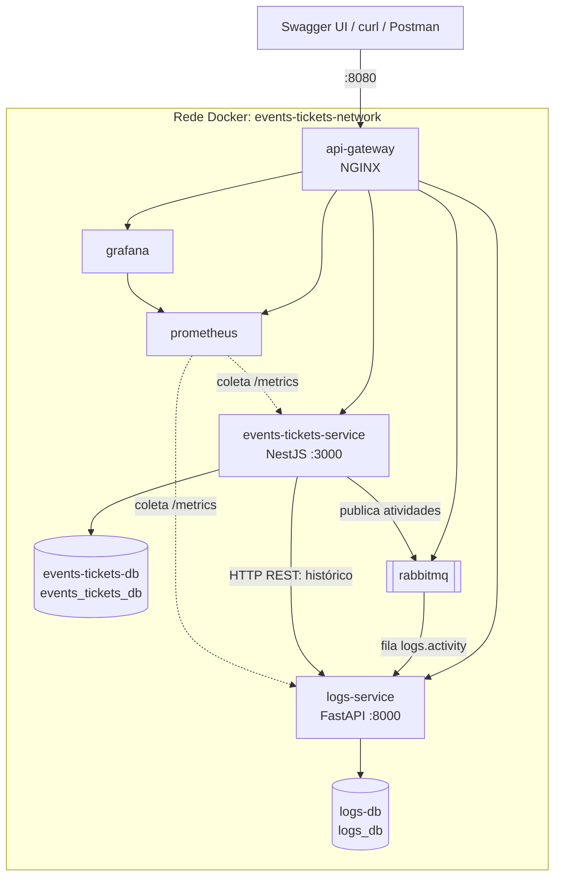

# events-tickets-ms

Plataforma distribuída de gestão de eventos e emissão unificada de inscrições e ingressos, com registro de atividades, desenvolvida como Trabalho Prático da disciplina de Sistemas Distribuídos (UFMS).

O sistema é genérico: atende de simpósios acadêmicos e workshops online a shows, corridas de rua e campeonatos de e-sports. Inscrição e ingresso são a mesma entidade: ao se inscrever, o participante recebe um ingresso digital com código único e controle de presença (check-in). Cada mudança em eventos e ingressos fica registrada no serviço de logs, que permite consultar o histórico e fazer a triagem dos registros.

**Autor:** [Igor-Lazarin-Oliani](https://github.com/Igor-Lazarin-Oliani)

**Início rápido** (requer apenas Docker):

```sh
git clone https://github.com/Igor-Lazarin-Oliani/events-tickets-ms.git
cd events-tickets-ms
docker compose up --build -d
```

Depois, abra o Swagger de [eventos e ingressos](http://localhost:8080/docs/events-tickets) e de [logs](http://localhost:8080/docs/logs), ou siga o [roteiro de demonstração](#roteiro-de-demonstração).

## Requisitos atendidos

| Requisito | Como é atendido |
|---|---|
| Heterogeneidade e CRUD | `events-tickets-service` em TypeScript/NestJS (CRUD de eventos e de ingressos) e `logs-service` em Python/FastAPI (CRUD de registros de atividade) |
| Banco por serviço | `events-tickets-db` e `logs-db`, instâncias PostgreSQL separadas |
| Conteinerização | Um `Dockerfile` por serviço e `docker-compose.yml` orquestrando os 8 contêineres na rede `events-tickets-network` |
| API Gateway | NGINX como única porta de entrada, com lista de rotas permitidas |
| Comunicação entre serviços | JSON via RabbitMQ para gravar cada atividade, e HTTP REST síncrono para consultar o histórico |
| Documentação interativa | Swagger UI dos dois serviços, acessível pelo gateway |
| Observabilidade | Prometheus coletando as métricas dos serviços, painéis no Grafana e logs estruturados correlacionados entre gateway e serviços |
| Mensageria assíncrona (bônus) | RabbitMQ com padrão outbox: toda mudança em eventos e ingressos vira uma mensagem consumida pelo `logs-service` |

## Arquitetura

O ambiente tem um API Gateway como única porta de entrada, dois microsserviços em tecnologias diferentes, cada um com seu próprio banco de dados, mensageria assíncrona com RabbitMQ e uma camada de observabilidade com Prometheus e Grafana.



| Componente | Tecnologia | Responsabilidade |
|---|---|---|
| `api-gateway` | NGINX | Entrada única e roteamento para os serviços |
| `events-tickets-service` | Node.js 20, NestJS, TypeORM | Eventos, vagas, inscrições, ingressos e check-in |
| `logs-service` | Python 3.11, FastAPI, SQLAlchemy 2, Pydantic v2 | Registro de atividades: histórico e triagem |
| `events-tickets-db` | PostgreSQL 16 | Banco exclusivo do `events-tickets-service` |
| `logs-db` | PostgreSQL 16 | Banco exclusivo do `logs-service` |
| `rabbitmq` | RabbitMQ | Mensageria assíncrona entre os serviços |
| `prometheus` | Prometheus | Coleta das métricas dos serviços |
| `grafana` | Grafana | Painéis de telemetria |

### Por que essa divisão

**Eventos e ingressos ficam juntos** porque compartilham a regra mais importante do domínio: nunca vender mais ingressos que vagas. No mesmo banco, reservar a vaga e emitir o ingresso acontecem em uma única transação. Se algo falhar, tudo é desfeito, e não há compensação entre serviços a fazer.

**O registro de atividades fica separado** porque tem outra natureza: só acrescenta dados, tem outra retenção e não pode impedir uma venda se cair. Por isso:

- recebe as atividades de forma assíncrona, pelo RabbitMQ, sem que o serviço principal espere por ele;
- tem banco próprio e é consultado por HTTP só para montar o histórico;
- se ficar fora do ar, vendas e inscrições continuam, e as atividades aguardam na fila.

O `logs-service` é um serviço de domínio (auditoria do que aconteceu com eventos e ingressos). A observabilidade técnica, com métricas e painéis, continua com Prometheus e Grafana.

## Principais fluxos

**Emissão de ingresso (`POST /tickets`):** o serviço valida o evento e a duplicidade e, em uma única transação, reserva a vaga, salva o ingresso e grava as atividades `ticket.issued` e `event.spot_reserved`. Qualquer falha desfaz tudo, inclusive a vaga.

**Cancelamento (`DELETE /tickets/{id}`):** na mesma transação, o ingresso passa para `CANCELLED`, o registro é mantido, a vaga volta ao evento e as atividades são gravadas.

**Cancelamento ou remoção de evento:** na mesma transação, os ingressos ativos do evento são cancelados. A resposta já sai com tudo atualizado, e os ingressos mantêm uma cópia dos dados do evento (`event_snapshot`).

**Registro de atividades (assíncrono):** cada mudança grava mensagens na tabela `outbox_messages`, na mesma transação (padrão *outbox*). A cada segundo, o serviço principal as publica no RabbitMQ, e o `logs-service` as grava. Se o broker ou o `logs-service` estiverem fora do ar, as mensagens aguardam e são entregues quando eles voltarem.

**Histórico (síncrono):** `GET /events/{id}/history` e `GET /tickets/{id}/history` consultam o `logs-service` por HTTP e devolvem as atividades em ordem cronológica. Com o `logs-service` fora do ar, só essas rotas respondem `503`.

**Regras principais:**

- A reserva de vagas é atômica, e requisições simultâneas não vendem mais vagas do que existem.
- O evento passa para `SOLD_OUT` ao esgotar e volta para `PUBLISHED` quando uma vaga é devolvida.
- Cada documento pode ter apenas uma inscrição ativa por evento.
- Ao alterar a capacidade de um evento, as vagas já ocupadas são preservadas.
- Um evento cancelado não pode ser reaberto.
- Um registro de atividade não pode ser reescrito: só a triagem (`status` e `notes`) muda, e excluir significa arquivar.

## Endpoints

Todas as rotas públicas são acessadas pelo gateway, em `http://localhost:8080`.

### `events-tickets-service`

| Método e rota | Descrição |
|---|---|
| `POST /events` | Cria um evento |
| `GET /events` | Lista os eventos (filtros: `category`, `status`) |
| `GET /events/{id}` | Busca um evento |
| `PUT /events/{id}` | Atualiza um evento; `CANCELLED` cancela os ingressos ativos |
| `DELETE /events/{id}` | Remove o evento e cancela os ingressos ativos |
| `GET /events/{id}/history` | Histórico do evento, vindo do `logs-service` |
| `POST /tickets` | Realiza a inscrição e emite o ingresso |
| `GET /tickets` | Lista os ingressos (filtros: `event_id`, `participant_email`, `status`) |
| `GET /tickets/{id}` | Consulta por UUID ou `ticket_code` |
| `PUT /tickets/{id}` | Atualiza o ingresso ou realiza o check-in |
| `DELETE /tickets/{id}` | Cancela o ingresso e devolve a vaga |
| `GET /tickets/{id}/history` | Histórico do ingresso, vindo do `logs-service` |

### `logs-service`

| Método e rota | Descrição |
|---|---|
| `POST /logs` | Cria um registro manual, como uma ocorrência anotada pela organização |
| `GET /logs` | Lista os registros (filtros: `entity_type`, `entity_id`, `action`, `level`, `status`, `source`, `correlation_id`, `include_archived`; ordem e paginação com `order`, `limit` e `offset`) |
| `GET /logs/{id}` | Busca um registro, mesmo arquivado |
| `PUT /logs/{id}` | Atualiza a triagem: `status` (`NEW`, `REVIEWED`, `RESOLVED`) e `notes` |
| `DELETE /logs/{id}` | Arquiva o registro |

### Documentação e telemetria

Disponíveis pelo gateway, com o ambiente em execução:

| Recurso | Eventos e ingressos | Logs |
|---|---|---|
| Swagger UI | http://localhost:8080/docs/events-tickets | http://localhost:8080/docs/logs |
| Métricas Prometheus | http://localhost:8080/metrics/events-tickets | http://localhost:8080/metrics/logs |
| Saúde | http://localhost:8080/health/events-tickets | http://localhost:8080/health/logs |

| Ferramenta | Endereço | Acesso |
|---|---|---|
| Painel Grafana | http://localhost:8080/grafana/ | Abre sem login, somente leitura. Para editar: `admin` / `admin` |
| Prometheus (alvos da coleta) | http://localhost:8080/prometheus/targets | Sem login |
| RabbitMQ (filas e mensagens) | http://localhost:8080/rabbitmq/ | `events_tickets` / `events_tickets_pass` |

Nos dois Swaggers, `/health` e `/metrics` aparecem documentadas como rotas internas; pelo gateway, use os endereços da tabela acima.

Os logs dos contêineres são estruturados, com marcadores como `[GATEWAY]`, `[TICKET ISSUED]`, `[EVENT SPOT RESERVED]`, `[ACTIVITY MESSAGE PUBLISHED]`, `[ACTIVITY LOGGED]`, `[HTTP SYNC REQUEST]` e `[TELEMETRY]`. O cabeçalho `X-Correlation-Id` liga os logs do gateway, dos dois serviços e as mensagens do RabbitMQ em uma mesma operação.

## Como executar

O único pré-requisito é o Docker com o Docker Compose. A porta 8080 precisa estar livre.

```sh
# obter o código
git clone https://github.com/Igor-Lazarin-Oliani/events-tickets-ms.git
cd events-tickets-ms

# construir as imagens e subir os contêineres
docker compose up --build -d

# conferir: todos devem aparecer como "healthy"
docker compose ps

# acompanhar os logs
docker compose logs -f api-gateway events-tickets-service logs-service
```

Para encerrar:

```sh
docker compose down      # mantém os dados
docker compose down -v   # apaga também os dados
```

Só o `api-gateway` publica porta no host. Serviços e bancos ficam acessíveis apenas na rede interna; para inspecionar um banco, use, por exemplo:

```sh
docker compose exec events-tickets-db psql -U events_tickets_user -d events_tickets_db -c 'select title, available_spots, status from events;'
docker compose exec events-tickets-db psql -U events_tickets_user -d events_tickets_db -c 'select ticket_code, status from tickets;'
docker compose exec logs-db psql -U logs_user -d logs_db -c 'select occurred_at, action, level from activity_logs order by occurred_at;'
```

As credenciais estão no `docker-compose.yml` e são exclusivas do ambiente local deste trabalho.

## Roteiro de demonstração

O roteiro parte de um ambiente no ar. Pode ser feito pelo Swagger UI ou pelos comandos `curl` mais abaixo.

### Pelo Swagger UI

| # | Onde | Ação | Resultado esperado |
|---|---|---|---|
| 1 | Eventos e ingressos, `POST /events` | Executar o exemplo, que já tem `max_capacity: 2`, e copiar o `id` | `201`, `available_spots: 2`, `PUBLISHED` |
| 2 | Eventos e ingressos, `POST /tickets` | Emitir 2 ingressos com esse `event_id` e `participant_document` diferentes | `201` nos dois, com `ticket_code` no formato `EVT-2026-XXXXXX` |
| 3 | Eventos e ingressos, `GET /events/{id}` | Consultar o evento | `available_spots: 0`, `SOLD_OUT` |
| 4 | Eventos e ingressos, `POST /tickets` | Tentar um 3º ingresso, com outro documento | `409 Event is sold out` |
| 5 | Eventos e ingressos, `PUT /tickets/{id}` | Enviar `{"status": "CHECKED_IN"}` para o 1º ingresso | `200`, `CHECKED_IN` |
| 6 | Eventos e ingressos, `DELETE /tickets/{id}` | Cancelar o 2º ingresso | `200`, `CANCELLED` |
| 7 | Eventos e ingressos, `GET /events/{id}` | Consultar o evento novamente | `available_spots: 1`, `PUBLISHED` |
| 8 | Eventos e ingressos, `GET /events/{id}/history` | Consultar o histórico do evento | `event.created`, duas `event.spot_reserved` e uma `event.spot_released` |
| 9 | Logs, `POST /logs` | Executar o exemplo, trocando o `entity_id` pelo do evento | `201`, `source: manual`, `status: NEW` |
| 10 | Logs, `PUT /logs/{id}` e `DELETE /logs/{id}` | Mudar a triagem e depois arquivar | `REVIEWED`; depois `archived_at` preenchido |
| 11 | [Grafana](http://localhost:8080/grafana/) | Abrir o painel inicial | Serviços no ar, ingressos, vagas, registros, requisições, latência e mensagens |
| 12 | [Prometheus](http://localhost:8080/prometheus/targets) | Abrir os alvos da coleta | `events-tickets-service` e `logs-service` como `UP` |
| 13 | [RabbitMQ](http://localhost:8080/rabbitmq/) | Abrir a fila `logs.activity` | Fila durável, com consumidor ativo |

### Por `curl`

Execute em um terminal Bash (no Windows, use o Git Bash), na raiz do repositório, um passo de cada vez:

```sh
# Preparação
GATEWAY=http://localhost:8080
JSON='Content-Type: application/json'
extract_id() { sed -E 's/.*"id":"([^"]+)".*/\1/'; }
show_event() { curl -s "$GATEWAY/events/$EVENT_ID"; echo; }
issue() {
  curl -s -X POST "$GATEWAY/tickets" -H "$JSON" -H "X-Correlation-Id: demo-$3" \
    -d "{\"event_id\":\"$EVENT_ID\",\"participant_name\":\"$1\",\"participant_email\":\"$2\",\"participant_document\":\"$3\"}"
}

# 1. Criar um evento com 2 vagas
EVENT=$(curl -s -X POST "$GATEWAY/events" -H "$JSON" -d '{"title":"Workshop Docker","category":"WORKSHOP","modality":"ONLINE","location":"https://example.com/live","start_at":"2026-11-20T08:00:00-04:00","end_at":"2026-11-20T18:00:00-04:00","max_capacity":2}')
echo "$EVENT"
EVENT_ID=$(echo "$EVENT" | extract_id)

# 2. Emitir 2 ingressos: as vagas chegam a 0 e o evento fica SOLD_OUT
TICKET_1=$(issue 'Ana Lima' 'ana@example.com' '2026000001')
echo "$TICKET_1"
TICKET_2=$(issue 'Bruno Reis' 'bruno@example.com' '2026000002')
echo "$TICKET_2"
TICKET_1_ID=$(echo "$TICKET_1" | extract_id)
TICKET_2_ID=$(echo "$TICKET_2" | extract_id)
show_event

# 3. O 3º ingresso é barrado com 409 Event is sold out
issue 'Carla Dias' 'carla@example.com' '2026000003'; echo

# 4. Check-in do 1º ingresso
curl -s -X PUT "$GATEWAY/tickets/$TICKET_1_ID" -H "$JSON" -d '{"status":"CHECKED_IN"}'; echo

# 5. Cancelar o 2º ingresso: a vaga volta e o evento fica PUBLISHED
curl -s -X DELETE "$GATEWAY/tickets/$TICKET_2_ID"; echo
show_event

# 6. Histórico: o serviço principal consulta o logs-service por HTTP
sleep 2   # os registros chegam ao logs-service pelo RabbitMQ em cerca de 1 s
curl -s "$GATEWAY/tickets/$TICKET_1_ID/history"; echo
curl -s "$GATEWAY/events/$EVENT_ID/history"; echo

# 7. CRUD de logs: registrar, fazer a triagem e arquivar uma ocorrência
LOG=$(curl -s -X POST "$GATEWAY/logs" -H "$JSON" -d "{\"action\":\"incident.reported\",\"entity_type\":\"event\",\"entity_id\":\"$EVENT_ID\",\"level\":\"WARNING\",\"message\":\"Projetor do auditorio com defeito\"}")
echo "$LOG"
LOG_ID=$(echo "$LOG" | extract_id)
curl -s -X PUT "$GATEWAY/logs/$LOG_ID" -H "$JSON" -d '{"status":"RESOLVED","notes":"Projetor trocado"}'; echo
curl -s -X PUT "$GATEWAY/logs/$LOG_ID" -H "$JSON" -d '{"message":"reescrever o fato"}'; echo   # 422: o fato é imutável
curl -s -X DELETE "$GATEWAY/logs/$LOG_ID"; echo                                               # arquiva

# 8. Telemetria
curl -s "$GATEWAY/metrics/events-tickets" | grep -E '^(tickets_(issued|cancelled)_total|events_spot_operations_total)'
curl -s "$GATEWAY/metrics/logs" | grep -E '^logs_(entries_created|messages_consumed)_total'
docker compose logs api-gateway events-tickets-service logs-service | grep demo-2026000001
```

O último comando mostra uma única inscrição atravessando o sistema: o mesmo `X-Correlation-Id` aparece no gateway, no `events-tickets-service`, na mensagem publicada no RabbitMQ e no registro gravado pelo `logs-service`.

### Persistência dos dados

Mesmo removendo os contêineres, os dados continuam nos volumes:

```sh
docker compose down
docker compose up -d --wait

# O evento continua com available_spots 1 e status PUBLISHED, e o histórico continua lá
show_event
curl -s "$GATEWAY/tickets/$TICKET_1_ID/history"; echo
```

### Cancelamento de evento

Cancelar um evento cancela os ingressos ativos na mesma transação:

```sh
EVENT=$(curl -s -X POST "$GATEWAY/events" -H "$JSON" -d '{"title":"Festival Indie","category":"CONCERT","modality":"IN_PERSON","location":"Parque das Nacoes","start_at":"2026-12-05T18:00:00-04:00","end_at":"2026-12-05T23:00:00-04:00","max_capacity":10}')
EVENT_ID=$(echo "$EVENT" | extract_id)
issue 'Eva Nunes' 'eva@example.com' '2026000005'; echo
issue 'Fabio Ramos' 'fabio@example.com' '2026000006'; echo

curl -s -X PUT "$GATEWAY/events/$EVENT_ID" -H "$JSON" -d '{"status":"CANCELLED"}'; echo

# Os 2 ingressos já aparecem como CANCELLED
curl -s "$GATEWAY/tickets?event_id=$EVENT_ID&status=CANCELLED"; echo

# Um evento cancelado não pode ser reaberto: 409
curl -s -X PUT "$GATEWAY/events/$EVENT_ID" -H "$JSON" -d '{"status":"PUBLISHED"}'; echo
```

### Falha do `logs-service` (opcional)

Com o serviço de logs fora do ar, a venda continua, e só o histórico fica indisponível:

```sh
docker compose stop logs-service

# Criar um evento e emitir um ingresso funcionam normalmente
EVENT=$(curl -s -X POST "$GATEWAY/events" -H "$JSON" -d '{"title":"Hackathon UFMS","category":"ACADEMIC","modality":"HYBRID","location":"FACOM","start_at":"2026-12-10T08:00:00-04:00","end_at":"2026-12-10T20:00:00-04:00","max_capacity":30}')
EVENT_ID=$(echo "$EVENT" | extract_id)
TICKET_3_ID=$(issue 'Gabi Souza' 'gabi@example.com' '2026000007' | extract_id)
curl -s "$GATEWAY/tickets/$TICKET_3_ID"; echo

# Só o histórico responde 503 Logs service unavailable
curl -s "$GATEWAY/tickets/$TICKET_3_ID/history"; echo

docker compose up -d --wait logs-service
sleep 3

# As atividades que esperavam na fila foram gravadas
curl -s "$GATEWAY/tickets/$TICKET_3_ID/history"; echo
```

### Falha do RabbitMQ (opcional)

Com o broker fora do ar, a API continua respondendo, e as atividades aguardam na outbox:

```sh
docker compose stop rabbitmq
EVENT=$(curl -s -X POST "$GATEWAY/events" -H "$JSON" -d '{"title":"Corrida de Rua","category":"SPORTS","modality":"IN_PERSON","location":"Parque Laguna","start_at":"2026-12-06T07:00:00-04:00","end_at":"2026-12-06T11:00:00-04:00","max_capacity":10}')
EVENT_ID=$(echo "$EVENT" | extract_id)

# A mensagem event.created aguarda publicação
docker compose exec events-tickets-db psql -U events_tickets_user -d events_tickets_db -c 'select routing_key from outbox_messages where published_at is null;'

docker compose up -d --wait rabbitmq
sleep 10

# A mensagem foi entregue e já aparece no histórico
curl -s "$GATEWAY/events/$EVENT_ID/history"; echo
```

## Testes

Os testes automatizados não precisam de banco de dados nem de Docker, mas exigem Node.js 20 e Python 3.11 instalados.

```sh
# events-tickets-service
cd microservices/events-tickets-service
npm ci
npm test

# logs-service
cd microservices/logs-service
pip install -r requirements-dev.txt
pytest
```

## Estrutura do repositório

```
events-tickets-ms/
├── README.md
├── docker-compose.yml            # Orquestração dos contêineres
├── gateway/                      # Configuração do API Gateway (NGINX)
├── messaging/                    # Configuração do RabbitMQ
├── observability/                # Configuração do Prometheus e do Grafana
├── docs/                         # Documentação do projeto
└── microservices/
    ├── events-tickets-service/   # Node.js + NestJS (eventos e ingressos)
    └── logs-service/             # Python + FastAPI (registro de atividades)
```

## Documentação

| Documento | Conteúdo |
|---|---|
| [docs/prompt.md](docs/prompt.md) | Especificação completa e fases do projeto |
| [docs/arquitetura.md](docs/arquitetura.md) | Topologia, configuração e observabilidade |
| [docs/contratos-api.md](docs/contratos-api.md) | Contratos, regras de negócio, mensagens e erros |
| [docs/decisoes.md](docs/decisoes.md) | Decisões de projeto e justificativas |
| [docs/guia-da-implementacao.md](docs/guia-da-implementacao.md) | Explicação completa da implementação |
| [docs/roteiro-apresentacao.md](docs/roteiro-apresentacao.md) | Roteiro da apresentação |
| [docs/AGENTS.md](docs/AGENTS.md) | Regras para agentes de código |
