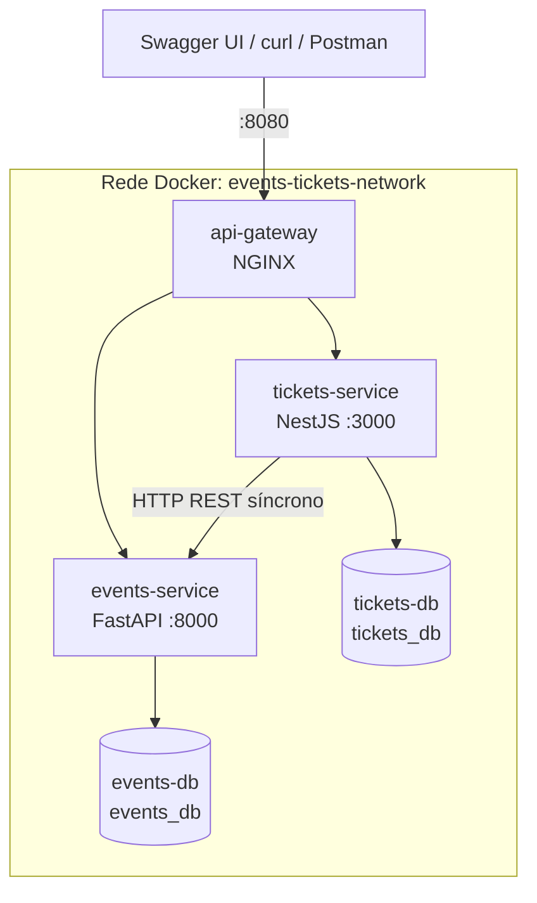

# events-tickets-ms

Plataforma distribuída de gestão de eventos e emissão unificada de inscrições e ingressos, desenvolvida como Trabalho Prático da disciplina de Sistemas Distribuídos (UFMS).

O sistema é genérico: atende de simpósios acadêmicos e workshops online a shows, corridas de rua e campeonatos de e-sports. Inscrição e ingresso são a mesma entidade: ao se inscrever, o participante recebe um ingresso digital com código único e controle de presença (check-in).

**Autor:** [Igor-Lazarin-Oliani](https://github.com/Igor-Lazarin-Oliani)

**Início rápido** (requer apenas Docker):

```sh
git clone https://github.com/Igor-Lazarin-Oliani/events-tickets-ms.git
cd events-tickets-ms
docker compose up --build -d
```

Depois, abra o Swagger de [eventos](http://localhost:8080/docs/events) e de [ingressos](http://localhost:8080/docs/tickets), ou siga o [roteiro de demonstração](#roteiro-de-demonstração).

## Requisitos atendidos

| Requisito | Como é atendido |
|---|---|
| Heterogeneidade e CRUD | `events-service` em Python/FastAPI e `tickets-service` em TypeScript/NestJS, ambos com CRUD completo |
| Banco por serviço | `events-db` e `tickets-db`, instâncias PostgreSQL separadas |
| Conteinerização | Um `Dockerfile` por serviço e `docker-compose.yml` orquestrando tudo na rede `events-tickets-network` |
| API Gateway | NGINX como única porta de entrada, com lista de rotas permitidas |
| Comunicação entre serviços | HTTP REST/JSON síncrono para validar o evento, reservar e devolver vagas |
| Documentação interativa | Swagger UI dos dois serviços, acessível pelo gateway |
| Observabilidade | `/metrics` no padrão Prometheus, `/health` e logs estruturados correlacionados entre gateway e serviços |

## Arquitetura

O ambiente tem um API Gateway como única porta de entrada e dois microsserviços em tecnologias diferentes, cada um com seu próprio banco de dados.



| Componente | Tecnologia | Responsabilidade |
|---|---|---|
| `api-gateway` | NGINX | Entrada única e roteamento para os serviços |
| `events-service` | Python 3.11, FastAPI, SQLAlchemy 2, Pydantic v2 | Catálogo de eventos e controle de vagas |
| `tickets-service` | Node.js 20, NestJS, TypeORM | Inscrições, ingressos e check-in |
| `events-db` | PostgreSQL 16 | Banco exclusivo do `events-service` |
| `tickets-db` | PostgreSQL 16 | Banco exclusivo do `tickets-service` |

### Por que dois serviços

Eventos e inscrições têm responsabilidades e dados diferentes: o catálogo muda pouco e controla a capacidade, enquanto as inscrições concentram os dados dos participantes e o check-in. A separação permite que cada parte evolua, escale e falhe de forma independente.

- O `events-service` é a fonte da verdade sobre a capacidade dos eventos e não conhece os ingressos.
- O `tickets-service` guarda apenas uma referência ao evento e uma cópia dos dados capturados na inscrição (`event_snapshot`), o que evita consultas entre bancos.
- Somente o `tickets-service` chama o outro serviço, e sempre por HTTP.

## Principais fluxos

**Emissão de ingresso (`POST /tickets`):** o `tickets-service` valida o evento, verifica se o participante já está inscrito, reserva a vaga no `events-service` e salva o ingresso. Se o salvamento falhar, a vaga é devolvida.

**Cancelamento (`DELETE /tickets/:id`):** o ingresso passa para `CANCELLED`, o registro é mantido e a vaga volta ao evento. Se o `events-service` estiver indisponível, o ingresso retorna ao status anterior e a API responde `503`.

**Regras principais:**

- A reserva de vagas é atômica, e requisições simultâneas não vendem mais vagas do que existem.
- O evento passa para `SOLD_OUT` ao esgotar e volta para `PUBLISHED` quando uma vaga é devolvida.
- Cada documento pode ter apenas uma inscrição ativa por evento.
- Ao alterar a capacidade de um evento, as vagas já ocupadas são preservadas.

## Endpoints

Todas as rotas públicas são acessadas pelo gateway, em `http://localhost:8080`.

### `events-service`

| Método e rota | Descrição |
|---|---|
| `POST /events` | Cria um evento |
| `GET /events` | Lista os eventos (filtros: `category`, `status`) |
| `GET /events/{id}` | Busca um evento |
| `PUT /events/{id}` | Atualiza um evento |
| `DELETE /events/{id}` | Remove um evento |
| `PATCH /events/{id}/reserve-spot` | Reserva uma vaga (interna, não exposta pelo gateway) |
| `PATCH /events/{id}/release-spot` | Devolve uma vaga (interna, não exposta pelo gateway) |

### `tickets-service`

| Método e rota | Descrição |
|---|---|
| `POST /tickets` | Realiza a inscrição e emite o ingresso |
| `GET /tickets` | Lista os ingressos (filtros: `event_id`, `participant_email`, `status`) |
| `GET /tickets/:id` | Consulta por UUID ou `ticket_code` |
| `PUT /tickets/:id` | Atualiza o ingresso ou realiza o check-in |
| `DELETE /tickets/:id` | Cancela o ingresso e devolve a vaga |

### Documentação e telemetria

Disponíveis pelo gateway, com o ambiente em execução:

| Recurso | Eventos | Ingressos |
|---|---|---|
| Swagger UI | http://localhost:8080/docs/events | http://localhost:8080/docs/tickets |
| Métricas Prometheus | http://localhost:8080/metrics/events | http://localhost:8080/metrics/tickets |
| Saúde | http://localhost:8080/health/events | http://localhost:8080/health/tickets |

Os logs são estruturados, com marcadores como `[GATEWAY]`, `[HTTP SYNC REQUEST]`, `[EVENT SPOT RESERVED]`, `[EVENT SPOT RELEASED]` e `[TELEMETRY]`. O cabeçalho `X-Correlation-Id` liga os logs do gateway e dos dois serviços em uma mesma operação.

## Como executar

O único pré-requisito é o Docker com o Docker Compose. A porta 8080 precisa estar livre.

```sh
# obter o código
git clone https://github.com/Igor-Lazarin-Oliani/events-tickets-ms.git
cd events-tickets-ms

# construir as imagens e subir os contêineres
docker compose up --build -d

# conferir: todos devem aparecer como "healthy"
docker compose ps

# acompanhar os logs
docker compose logs -f api-gateway events-service tickets-service
```

Para encerrar:

```sh
docker compose down      # mantém os dados
docker compose down -v   # apaga também os dados
```

Só o `api-gateway` publica porta no host. Serviços e bancos ficam acessíveis apenas na rede interna; para inspecionar um banco, use, por exemplo:

```sh
docker compose exec events-db psql -U events_user -d events_db -c 'select title, available_spots, status from events;'
docker compose exec tickets-db psql -U tickets_user -d tickets_db -c 'select ticket_code, status from tickets;'
```

As credenciais estão no `docker-compose.yml` e são exclusivas do ambiente local deste trabalho.

## Roteiro de demonstração

O roteiro parte de um ambiente no ar e mostra o caminho completo entre os dois serviços. Pode ser feito pelo Swagger UI ou pelos comandos `curl` mais abaixo.

### Pelo Swagger UI

| # | Onde | Ação | Resultado esperado |
|---|---|---|---|
| 1 | Eventos, `POST /events` | Executar o exemplo, que já tem `max_capacity: 2`, e copiar o `id` | `201`, `available_spots: 2`, `PUBLISHED` |
| 2 | Ingressos, `POST /tickets` | Emitir 2 ingressos com esse `event_id` e `participant_document` diferentes | `201` nos dois, com `ticket_code` no formato `EVT-2026-XXXXXX` |
| 3 | Eventos, `GET /events/{id}` | Consultar o evento | `available_spots: 0`, `SOLD_OUT` |
| 4 | Ingressos, `POST /tickets` | Tentar um 3º ingresso, com outro documento | `409 Event is sold out` |
| 5 | Ingressos, `PUT /tickets/{id}` | Enviar `{"status": "CHECKED_IN"}` para o 1º ingresso | `200`, `CHECKED_IN` |
| 6 | Ingressos, `DELETE /tickets/{id}` | Cancelar o 2º ingresso | `200`, `CANCELLED` |
| 7 | Eventos, `GET /events/{id}` | Consultar o evento novamente | `available_spots: 1`, `PUBLISHED` |
| 8 | `/metrics` e logs | Abrir as métricas e os logs dos contêineres | Contadores de ingressos e operações registradas |

### Por `curl`

Execute em um terminal Bash (no Windows, use o Git Bash), na raiz do repositório, um passo de cada vez:

```sh
# Preparação
GATEWAY=http://localhost:8080
JSON='Content-Type: application/json'
extract_id() { sed -E 's/.*"id":"([^"]+)".*/\1/'; }
show_event() { curl -s "$GATEWAY/events/$EVENT_ID"; echo; }
issue() {
  curl -s -X POST "$GATEWAY/tickets" -H "$JSON" -H "X-Correlation-Id: demo-$3" \
    -d "{\"event_id\":\"$EVENT_ID\",\"participant_name\":\"$1\",\"participant_email\":\"$2\",\"participant_document\":\"$3\"}"
}

# 1. Criar um evento com 2 vagas
EVENT=$(curl -s -X POST "$GATEWAY/events" -H "$JSON" -d '{"title":"Workshop Docker","category":"WORKSHOP","modality":"ONLINE","location":"https://example.com/live","start_at":"2026-11-20T08:00:00-04:00","end_at":"2026-11-20T18:00:00-04:00","max_capacity":2}')
echo "$EVENT"
EVENT_ID=$(echo "$EVENT" | extract_id)

# 2. Emitir 2 ingressos: as vagas chegam a 0 e o evento fica SOLD_OUT
TICKET_1=$(issue 'Ana Lima' 'ana@example.com' '2026000001')
echo "$TICKET_1"
TICKET_2=$(issue 'Bruno Reis' 'bruno@example.com' '2026000002')
echo "$TICKET_2"
TICKET_1_ID=$(echo "$TICKET_1" | extract_id)
TICKET_2_ID=$(echo "$TICKET_2" | extract_id)
show_event

# 3. O 3º ingresso é barrado com 409 Event is sold out
issue 'Carla Dias' 'carla@example.com' '2026000003'; echo

# 4. Check-in do 1º ingresso
curl -s -X PUT "$GATEWAY/tickets/$TICKET_1_ID" -H "$JSON" -d '{"status":"CHECKED_IN"}'; echo

# 5. Cancelar o 2º ingresso: a vaga volta e o evento fica PUBLISHED
curl -s -X DELETE "$GATEWAY/tickets/$TICKET_2_ID"; echo
show_event

# 6. O gateway não expõe a rota interna de reserva: 404 Route not found
curl -s -X PATCH "$GATEWAY/events/$EVENT_ID/reserve-spot"; echo

# 7. Telemetria
curl -s "$GATEWAY/metrics/tickets" | grep -E '^tickets_(issued|cancelled)_total'
curl -s "$GATEWAY/metrics/events" | grep '^events_spot_operations_total'
docker compose logs api-gateway events-service tickets-service | grep demo-2026000001
```

O último comando mostra uma única inscrição atravessando o sistema: o mesmo `X-Correlation-Id` aparece nos logs de `api-gateway`, `tickets-service` e `events-service`.

### Persistência dos dados

Mesmo removendo os contêineres, os dados continuam nos volumes:

```sh
docker compose down
docker compose up -d --wait

# O evento continua com available_spots 1 e status PUBLISHED
show_event
```

### Tolerância a falhas (opcional)

Com o `events-service` fora do ar, a emissão e o cancelamento falham sem deixar dados inconsistentes:

```sh
docker compose stop events-service

# As duas chamadas respondem 503 Events service unavailable
issue 'Daniel Melo' 'daniel@example.com' '2026000004'; echo
curl -s -X DELETE "$GATEWAY/tickets/$TICKET_1_ID"; echo

# O ingresso continua CHECKED_IN
curl -s "$GATEWAY/tickets/$TICKET_1_ID"; echo

docker compose start events-service
```

## Testes

Os testes automatizados não precisam de banco de dados nem de Docker, mas exigem Python 3.11 e Node.js 20 instalados.

```sh
# events-service
cd microservices/events-service
pip install -r requirements-dev.txt
pytest

# tickets-service
cd microservices/tickets-service
npm ci
npm test
```

## Estrutura do repositório

```
events-tickets-ms/
├── README.md
├── docker-compose.yml        # Orquestração dos contêineres
├── gateway/                  # Configuração do API Gateway (NGINX)
├── docs/                     # Documentação do projeto
└── microservices/
    ├── events-service/       # Python + FastAPI
    └── tickets-service/      # Node.js + NestJS
```

## Documentação

| Documento | Conteúdo |
|---|---|
| [docs/prompt.md](docs/prompt.md) | Especificação completa e fases do projeto |
| [docs/arquitetura.md](docs/arquitetura.md) | Topologia, configuração e observabilidade |
| [docs/contratos-api.md](docs/contratos-api.md) | Contratos, regras de negócio e erros |
| [docs/decisoes.md](docs/decisoes.md) | Decisões de projeto e justificativas |
| [docs/AGENTS.md](docs/AGENTS.md) | Regras para agentes de código |
