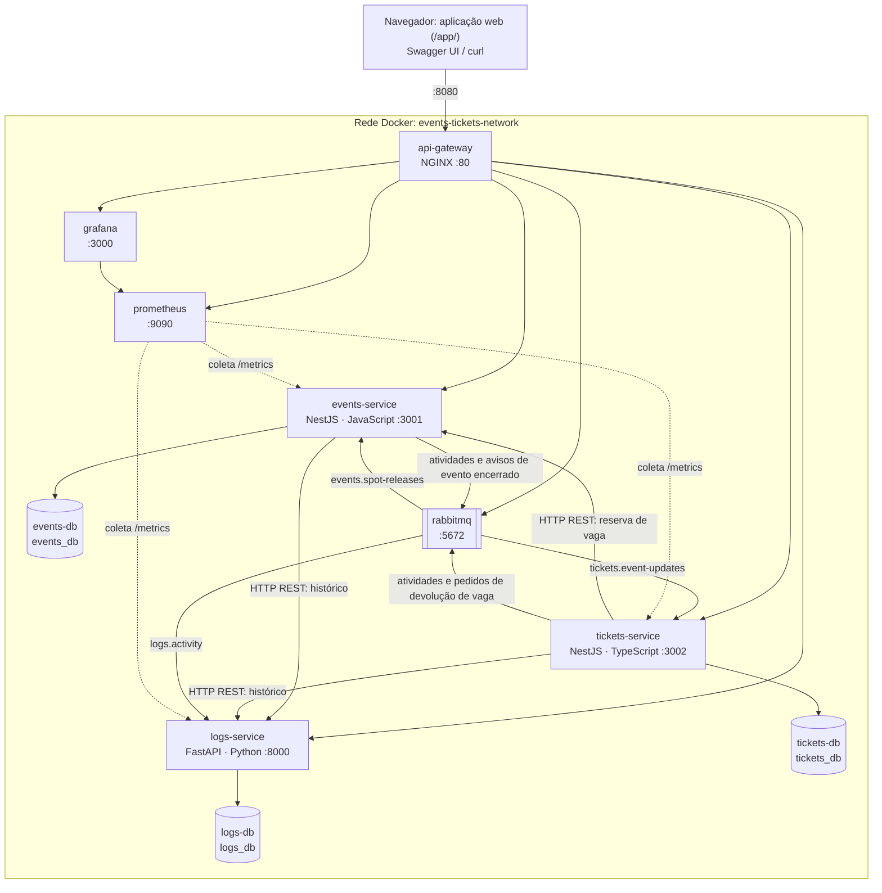

# Arquitetura

Visão geral da arquitetura do `events-tickets-ms`: contêineres, modelo de dados, comunicação entre os serviços, configuração e observabilidade. Os contratos das rotas e das mensagens estão em [contratos-api.md](contratos-api.md), e as justificativas, em [decisoes.md](decisoes.md).

## Histórico de versões

| Versão | Arquitetura |
|---|---|
| 1 | `events-service` (Python/FastAPI) e `tickets-service` (TypeScript/NestJS), com reserva de vagas por HTTP; depois, API Gateway, Prometheus e Grafana, e RabbitMQ para cancelar os ingressos de eventos cancelados |
| 2 | `events-tickets-service` (TypeScript/NestJS) e `logs-service` (Python/FastAPI), com registro de atividades pela outbox, histórico por HTTP e aplicação web |
| 3 (atual) | `events-service` (JavaScript/NestJS), `tickets-service` (TypeScript/NestJS) e `logs-service` (Python/FastAPI), cada um com seu banco (D29 a D36) |

## Topologia

| Contêiner | Tecnologia | Porta no host | Porta interna | Responsabilidade |
|---|---|---|---|---|
| `api-gateway` | NGINX 1.27 | 8080 | 80 | Entrada única, roteamento e arquivos da aplicação web |
| `events-service` | Node.js 20, NestJS em JavaScript (Babel), TypeORM | Nenhuma | 3001 | Eventos e vagas: reserva idempotente e devolução |
| `events-db` | PostgreSQL 16 | Nenhuma | 5432 | `events`, `spot_reservations` e `outbox_messages` |
| `tickets-service` | Node.js 20, NestJS em TypeScript, TypeORM | Nenhuma | 3002 | Inscrições, ingressos e check-in |
| `tickets-db` | PostgreSQL 16 | Nenhuma | 5432 | `tickets`, `closed_events` e `outbox_messages` |
| `logs-service` | Python 3.11, FastAPI, SQLAlchemy 2 | Nenhuma | 8000 | Registro de atividades (auditoria) |
| `logs-db` | PostgreSQL 16 | Nenhuma | 5432 | `activity_logs` |
| `rabbitmq` | RabbitMQ 3.13 | Nenhuma | 5672, 15672 | Mensageria assíncrona: 3 exchanges e 3 filas |
| `prometheus` | Prometheus 2.55 | Nenhuma | 9090 | Coleta e armazenamento de métricas |
| `grafana` | Grafana 11.4 | Nenhuma | 3000 | Painéis de telemetria |

## Modelo de dados

Cada serviço cria as próprias tabelas ao subir (D8). Nenhuma tabela referencia outro banco.

### `events_db` (`events-service`)

| Tabela | Colunas |
|---|---|
| `events` | `id` (UUID), `title`, `description`, `category` (padrão `GENERAL`), `modality` (`IN_PERSON`, `ONLINE`, `HYBRID`), `location`, `start_at` e `end_at` (com fuso), `max_capacity` (> 0), `available_spots` (de 0 a `max_capacity`), `status` (`PUBLISHED`, `SOLD_OUT`, `CANCELLED`, `FINISHED`), `metadata_info` (JSONB livre), `created_at`, `updated_at` |
| `spot_reservations` | `ticket_id` (UUID, chave primária), `event_id`, `status` (`RESERVED` ou `RELEASED`), `reserved_at`, `released_at`, `created_at`, `updated_at` (D30, D31) |
| `outbox_messages` | `id` (= `message_id`), `exchange`, `routing_key`, `payload` (JSONB), `created_at`, `published_at` (D20, D34) |

### `tickets_db` (`tickets-service`)

| Tabela | Colunas |
|---|---|
| `tickets` | `id` (UUID gerado antes da reserva), `ticket_code` (único, `EVT-2026-XXXXXX`), `event_id` (sem chave estrangeira), `event_snapshot` (JSONB com título, categoria, modalidade, local e início), `participant_name`, `participant_email`, `participant_document`, `modality_tier` (padrão `STANDARD`), `status` (`CONFIRMED`, `CHECKED_IN`, `CANCELLED`), `created_at`, `updated_at`; índice único parcial em `(event_id, participant_document)` para status diferente de `CANCELLED` (D3) |
| `closed_events` | `event_id` (UUID, chave primária), `reason` (`event_cancelled` ou `event_deleted`), `closed_at` (D32) |
| `outbox_messages` | Mesma estrutura do `events_db` |

### `logs_db` (`logs-service`)

| Tabela | Colunas |
|---|---|
| `activity_logs` | `id` (UUID), `message_id` (único; nulo nos registros manuais), `source` (`events-service`, `tickets-service` ou `manual`), `action`, `entity_type`, `entity_id`, `level` (`INFO`, `WARNING`, `ERROR`), `message`, `data` (JSONB, sem dados pessoais), `correlation_id`, `occurred_at`, `status` (`NEW`, `REVIEWED`, `RESOLVED`), `notes`, `archived_at`, `created_at`, `updated_at` (D19) |

## Comunicação entre os serviços

| De → para | Estilo | Para quê | Se o destino estiver fora |
|---|---|---|---|
| `tickets-service` → `events-service` | HTTP `PATCH /events/{id}/reserve-spot` | Reservar a vaga ao emitir (D30) | `POST /tickets` responde `503`, e a devolução é pedida |
| `tickets-service` → `events-service` | RabbitMQ `tickets.exchange` → `events.spot-releases` | Devolver a vaga ao cancelar ou compensar (D31) | O pedido espera na fila |
| `events-service` → `tickets-service` | RabbitMQ `events.exchange` → `tickets.event-updates` | Cancelar os ingressos de evento cancelado ou removido (D33) | O aviso espera na fila |
| `events-service` e `tickets-service` → `logs-service` | RabbitMQ `activities.exchange` → `logs.activity` | Gravar cada atividade (D20) | As atividades esperam na fila |
| `events-service` e `tickets-service` → `logs-service` | HTTP `GET /logs` | Montar o histórico (D21) | Só as rotas `/history` respondem `503` |

Toda mensagem sai de uma outbox, gravada na mesma transação da mudança. Com o RabbitMQ fora do ar, as mensagens esperam nas outbox dos dois bancos.

## Aplicação web

A pasta `frontend/` tem HTML, CSS e módulos JavaScript, sem build e sem dependências externas. O `api-gateway` monta a pasta em `/usr/share/nginx/app` e a serve em `/app/`, na mesma origem da API (D24). A página não tem regra de negócio: só chama as rotas públicas e mostra o que cada componente respondeu.

| Parte | Arquivo | Fonte dos dados |
|---|---|---|
| Eventos, ingressos e registros | `js/app.js` | Rotas públicas dos três serviços |
| Diagrama e saúde dos contêineres | `js/topology.js`, `js/monitor.js` | `/gateway/health`, `/health/*`, `/rabbitmq/api/queues/%2F/<fila>` (as três filas), `/prometheus/api/v1/query` e `/grafana/api/health` |
| Rastro de cada operação | `js/traces.js` | Resposta HTTP e `GET /logs?correlation_id=...`, até as atividades chegarem ao `logs-service` |

Cada operação envia um `X-Correlation-Id` com prefixo `ui-`. A emissão mostra a reserva no `events-service` como um passo próprio do rastro. A animação da parte assíncrona só começa quando os registros com esse identificador aparecem no `logs-service`, e o caminho desenhado vem do próprio registro: um `event.spot_released` passou pelo `events-service` (devolução), e um `ticket.cancelled` com `reason` de evento passou pelo `tickets-service` (cascata). A latência exibida é a diferença entre `occurred_at` e `created_at` dos registros, medida pelos próprios serviços. O RabbitMQ atualiza as estatísticas das filas a cada 1 s (`collect_statistics_interval` em `messaging/rabbitmq.conf`).

## Fronteiras entre os serviços

- O `events-service` é a fonte da verdade sobre eventos e vagas. Só ele muda `available_spots`, com `UPDATE` condicional, e cada vaga reservada tem uma linha em `spot_reservations`, identificada pelo `ticket_id` (D30).
- O `tickets-service` é a fonte da verdade sobre ingressos. Ele não lê o `events-db`: obtém o evento na resposta da reserva e guarda uma cópia no `event_snapshot`. Sabe que um evento foi encerrado pelo aviso do RabbitMQ (D32, D33).
- O `logs-service` guarda o registro das atividades e não conhece as regras de eventos e ingressos: só recebe fatos já ocorridos e permite consultá-los e fazer a triagem (D19). Ele não chama os outros serviços.
- Cada serviço acessa só o próprio banco. Nenhum serviço depende de outro para subir.

## Ordem de inicialização

`events-db`, `tickets-db`, `logs-db` e `rabbitmq` saudáveis → `events-service`, `tickets-service` e `logs-service`, em paralelo → `api-gateway` e `prometheus`, assim que o `events-service` e o `tickets-service` estiverem saudáveis → `grafana`. Cada dependência usa `depends_on` com `condition: service_healthy`, e os serviços criam as próprias tabelas ao subir.

Nada depende do `logs-service` para subir (D27), e o `tickets-service` não depende do `events-service` (D36). Se o `logs-service` demorar ou falhar, a venda segue pelo gateway, só as rotas de logs e de histórico respondem `503`, e o Prometheus mostra o alvo como `DOWN`. Se o `events-service` cair depois da subida, só a emissão de ingressos responde `503`.

Os 10 contêineres usam `restart: unless-stopped` (D27): um processo que cai volta sozinho, e um `docker compose stop` mantém o contêiner parado, como nos experimentos de falha.

## Configuração

Os valores padrão ficam no `docker-compose.yml`, para que a avaliação não dependa de `.env`. As credenciais são exclusivas do ambiente local do trabalho.

| Serviço | Variável | Uso |
|---|---|---|
| `events-service` e `tickets-service` | `DATABASE_URL`, `RABBITMQ_URL`, `PORT`, `SERVICE_NAME` | Banco, broker e identificação |
| `events-service` e `tickets-service` | `LOGS_SERVICE_URL`, `LOGS_SERVICE_TIMEOUT_MS` | `http://logs-service:8000` e timeout do histórico (padrão: 3000) |
| `events-service` e `tickets-service` | `OUTBOX_POLL_INTERVAL_MS`, `RABBITMQ_RETRY_DELAY_MS` | Intervalo da outbox (1000) e espera após falha do broker ou do banco (5000) |
| `tickets-service` | `EVENTS_SERVICE_URL`, `EVENTS_SERVICE_TIMEOUT_MS` | `http://events-service:3001` e timeout da reserva (padrão: 3000) |
| `logs-service` | `DATABASE_URL`, `RABBITMQ_URL`, `PORT`, `SERVICE_NAME` | Banco, broker e identificação |
| `logs-service` | `RABBITMQ_RETRY_SECONDS` | Espera para reconectar ou reprocessar após falha (padrão: 5) |

## Observabilidade

- `GET /health` e `GET /metrics` (formato Prometheus) nos três serviços.
- O Prometheus coleta as métricas a cada 5 s (`observability/prometheus/prometheus.yml`), nos jobs `events-service`, `tickets-service` e `logs-service`.
- O Grafana sobe com fonte de dados e painel provisionados (`observability/grafana/`), e o painel "Visão Geral" é a página inicial.
- Métricas de requisições e latência nos três serviços; reservas e devoluções de vagas no `events-service`; ingressos, reservas pedidas e compensações no `tickets-service`; outbox e mensagens consumidas nos dois serviços NestJS; mensagens consumidas e registros gravados no `logs-service`.
- `outbox_messages_pending` é o total de mensagens que aguardam publicação em cada serviço, contado na tabela a cada ciclo, e não só o lote em andamento (D28). Com o broker fora do ar, mostra todo o acúmulo.
- Logs estruturados com método, rota, status e duração em milissegundos.
- O cabeçalho `X-Correlation-Id` é gerado ou reaproveitado pelo `api-gateway`, repassado entre os serviços por HTTP e nas mensagens, gravado em cada atividade e impresso nos logs de todos eles (D7).
- O `logs-service` é domínio, não ferramenta de observabilidade: o item de telemetria do edital é atendido por Prometheus e Grafana (D15).
