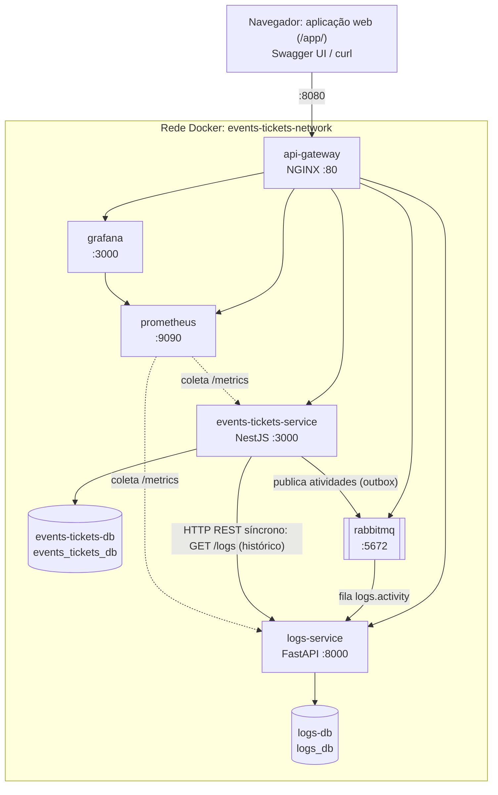

# Arquitetura

Visão do que existe e do que está previsto. A especificação completa está em [prompt.md](prompt.md).

## Estado da implementação

| Fase | Entrega | Estado |
|---|---|---|
| 1 | `events-service` (FastAPI + PostgreSQL) | Concluída; incorporada ao `events-tickets-service` na fase 8 |
| 2 | `tickets-service` (NestJS + PostgreSQL) | Concluída; incorporada ao `events-tickets-service` na fase 8 |
| 3 | `docker-compose.yml` com 4 contêineres | Concluída e validada |
| 4 | `README.md` e roteiro de demonstração | Concluída e validada |
| 5 | API Gateway NGINX | Concluída e validada |
| 6 | Prometheus e Grafana | Concluída e validada |
| 7 | Mensageria com RabbitMQ (bônus) | Concluída e validada |
| 8 | Reestruturação: `events-tickets-service` (NestJS) + `logs-service` (Python) | Concluída e validada em contêiner |
| 9 | Aplicação web estática servida pelo `api-gateway` (D24) | Concluída e validada no navegador |

Atualize esta tabela ao concluir cada fase.

## Topologia

| Contêiner | Tecnologia | Porta no host | Porta interna | Responsabilidade |
|---|---|---|---|---|
| `api-gateway` | NGINX 1.27 | 8080 | 80 | Entrada única, roteamento e arquivos da aplicação web |
| `events-tickets-service` | Node.js 20, NestJS, TypeORM | Nenhuma | 3000 | Eventos, vagas, inscrições, ingressos e check-in |
| `events-tickets-db` | PostgreSQL 16 | Nenhuma | 5432 | Dados de `events_tickets_db` |
| `logs-service` | Python 3.11, FastAPI, SQLAlchemy 2 | Nenhuma | 8000 | Registro de atividades (auditoria) |
| `logs-db` | PostgreSQL 16 | Nenhuma | 5432 | Dados de `logs_db` |
| `rabbitmq` | RabbitMQ 3.13 | Nenhuma | 5672, 15672 | Mensageria assíncrona |
| `prometheus` | Prometheus 2.55 | Nenhuma | 9090 | Coleta e armazenamento de métricas |
| `grafana` | Grafana 11.4 | Nenhuma | 3000 | Painéis de telemetria |

## Aplicação web

A pasta `frontend/` tem HTML, CSS e módulos JavaScript, sem build e sem dependências externas. O `api-gateway` monta a pasta em `/usr/share/nginx/app` e a serve em `/app/`, na mesma origem da API (D24). A página não tem regra de negócio: só chama as rotas públicas e mostra o que cada componente respondeu.

| Parte | Arquivo | Fonte dos dados |
|---|---|---|
| Eventos, ingressos e registros | `js/app.js` | Rotas públicas dos dois serviços |
| Diagrama e saúde dos contêineres | `js/topology.js`, `js/monitor.js` | `/gateway/health`, `/health/*`, `/rabbitmq/api/queues/%2F/logs.activity`, `/prometheus/api/v1/query` e `/grafana/api/health` |
| Rastro de cada operação | `js/traces.js` | Resposta HTTP e `GET /logs?correlation_id=...`, até as atividades chegarem ao `logs-service` |

Cada operação envia um `X-Correlation-Id` com prefixo `ui-`. A animação da parte assíncrona só começa quando os registros com esse identificador aparecem no `logs-service`. A latência exibida é a diferença entre `occurred_at` e `created_at` dos registros, medida pelos próprios serviços. O RabbitMQ atualiza as estatísticas das filas a cada 1 s (`collect_statistics_interval` em `messaging/rabbitmq.conf`).

## Fronteiras entre os serviços

- O `events-tickets-service` é a fonte da verdade sobre eventos, vagas e ingressos. Reserva e emissão, cancelamento e devolução, e o cancelamento em cascata de um evento acontecem em transações locais (D18, D22).
- O `logs-service` guarda o registro das atividades e não conhece as regras de eventos e ingressos: só recebe fatos já ocorridos e permite consultá-los e fazer a triagem (D19).
- Gravação é assíncrona: o `events-tickets-service` grava as atividades na outbox e as publica no RabbitMQ, sem saber quem as consome (D20).
- Consulta é síncrona: só o `events-tickets-service` chama o `logs-service` por HTTP, nas rotas de histórico (D21). O `logs-service` não chama o `events-tickets-service`.
- Cada serviço acessa só o próprio banco. Se o `logs-service` cair, vendas e inscrições seguem; as atividades esperam na outbox ou na fila.

## Ordem de inicialização

`events-tickets-db`, `logs-db` e `rabbitmq` saudáveis → `events-tickets-service` e `logs-service` saudáveis, em paralelo → `api-gateway` e `prometheus` → `grafana`. Cada dependência usa `depends_on` com `condition: service_healthy`, e os serviços criam as próprias tabelas ao subir. O `events-tickets-service` não depende do `logs-service` para subir.

## Configuração

Os valores padrão ficam no `docker-compose.yml`, para que a avaliação não dependa de `.env`. As credenciais são exclusivas do ambiente local do trabalho.

| Serviço | Variável | Uso |
|---|---|---|
| `events-tickets-service` | `DATABASE_URL`, `RABBITMQ_URL`, `PORT`, `SERVICE_NAME` | Banco, broker e identificação |
| `events-tickets-service` | `LOGS_SERVICE_URL` | `http://logs-service:8000` |
| `events-tickets-service` | `LOGS_SERVICE_TIMEOUT_MS` | Timeout da consulta de histórico (padrão: 3000) |
| `events-tickets-service` | `OUTBOX_POLL_INTERVAL_MS`, `RABBITMQ_RETRY_DELAY_MS` | Intervalo da outbox (1000) e espera após falha do broker (5000) |
| `logs-service` | `DATABASE_URL`, `RABBITMQ_URL`, `PORT`, `SERVICE_NAME` | Banco, broker e identificação |
| `logs-service` | `RABBITMQ_RETRY_SECONDS` | Espera para reconectar ou reprocessar após falha (padrão: 5) |

## Observabilidade

- `GET /health` e `GET /metrics` (formato Prometheus) nos dois serviços.
- O Prometheus coleta as métricas a cada 5 s (`observability/prometheus/prometheus.yml`), nos jobs `events-tickets-service` e `logs-service`.
- O Grafana sobe com fonte de dados e painel provisionados (`observability/grafana/`), e o painel "Visão Geral" é a página inicial.
- Métricas de requisições e latência nos dois serviços; ingressos emitidos e cancelados, operações de vagas e outbox no `events-tickets-service`; mensagens consumidas e registros gravados no `logs-service`.
- Logs estruturados com método, rota, status e duração em milissegundos.
- O cabeçalho `X-Correlation-Id` é gerado ou reaproveitado pelo `api-gateway`, repassado aos serviços, gravado em cada mensagem de atividade e impresso nos logs de todos eles (D7).
- O `logs-service` é domínio, não ferramenta de observabilidade: o item de telemetria do edital é atendido por Prometheus e Grafana (D15).
