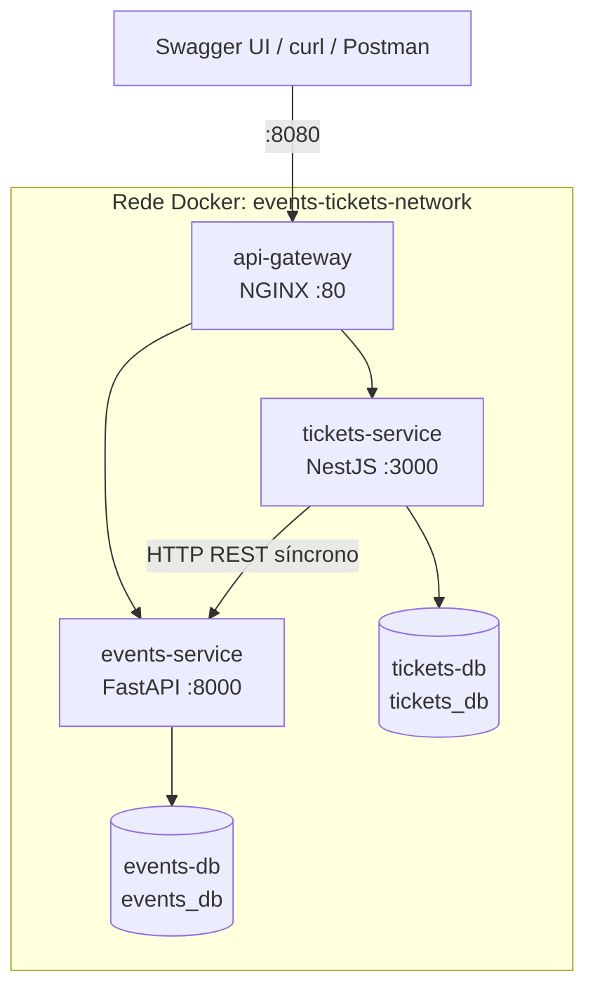

# Arquitetura

Visão do que existe e do que está previsto. A especificação completa está em [prompt.md](prompt.md).

## Estado da implementação

| Fase | Entrega | Estado |
|---|---|---|
| 1 | `events-service` (FastAPI + PostgreSQL) | Concluída e validada em contêiner |
| 2 | `tickets-service` (NestJS + PostgreSQL) | Concluída e validada em contêiner |
| 3 | `docker-compose.yml` com 4 contêineres | Concluída e validada |
| 4 | `README.md` e roteiro de demonstração | Concluída e validada |
| 5 | API Gateway NGINX | Concluída e validada |
| 6 | Prometheus e Grafana | Não iniciada |
| 7 | Mensageria com RabbitMQ (bônus) | Não iniciada |

Atualize esta tabela ao concluir cada fase.

## Topologia

| Contêiner | Tecnologia | Porta no host | Porta interna | Responsabilidade |
|---|---|---|---|---|
| `api-gateway` | NGINX 1.27 | 8080 | 80 | Entrada única e roteamento |
| `events-service` | Python 3.11, FastAPI, SQLAlchemy 2 | Nenhuma | 8000 | Eventos e capacidade |
| `events-db` | PostgreSQL 16 | Nenhuma | 5432 | Dados de `events_db` |
| `tickets-service` | Node.js 20, NestJS, TypeORM | Nenhuma | 3000 | Inscrições e ingressos |
| `tickets-db` | PostgreSQL 16 | Nenhuma | 5432 | Dados de `tickets_db` |

## Fronteiras entre os serviços

- O `events-service` é a fonte da verdade sobre capacidade e não conhece ingressos.
- O `tickets-service` guarda `event_id` como referência lógica, sem chave estrangeira, e copia os dados do evento em `event_snapshot` no momento da inscrição.
- A dependência é unidirecional: só o `tickets-service` chama o `events-service`.

## Ordem de inicialização

`events-db` e `tickets-db` saudáveis → `events-service` saudável → `tickets-service` saudável → `api-gateway`. Cada dependência usa `depends_on` com `condition: service_healthy`, e os serviços criam as próprias tabelas ao subir.

## Configuração

Os valores padrão ficam no `docker-compose.yml`, para que a avaliação não dependa de `.env`. As credenciais são exclusivas do ambiente local do trabalho.

| Serviço | Variável | Uso |
|---|---|---|
| `events-service` | `DATABASE_URL`, `PORT`, `SERVICE_NAME` | Banco e identificação |
| `tickets-service` | `DATABASE_URL`, `PORT`, `SERVICE_NAME` | Banco e identificação |
| `tickets-service` | `EVENTS_SERVICE_URL` | `http://events-service:8000` |
| `tickets-service` | `EVENTS_SERVICE_TIMEOUT_MS` | Timeout das chamadas ao Serviço A (padrão: 5000) |

## Observabilidade

- `GET /health` e `GET /metrics` (formato Prometheus) nos dois serviços, sem contêiner de Prometheus.
- Métricas de requisições e latência nos dois serviços, além de contadores de ingressos emitidos e cancelados no `tickets-service`.
- Logs estruturados com método, rota, status e duração em milissegundos.
- O cabeçalho `X-Correlation-Id` é gerado ou reaproveitado pelo `api-gateway`, repassado aos serviços e impresso nos logs de todos eles (D7).
