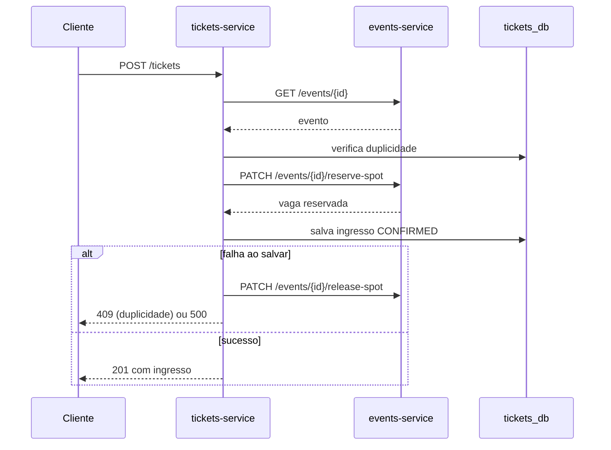

# Contratos da API

Regras de comportamento e erros dos dois serviços. Os campos das tabelas estão nas seções 5.1 e 5.2 do [prompt.md](prompt.md). As referências no formato D1, D2 etc. estão em [decisoes.md](decisoes.md).

Este documento deve continuar consistente com o Swagger em `/docs/events` e `/docs/tickets`.

## API Gateway (porta 8080)

Único ponto de entrada externo (D13, D14). Rotas não listadas respondem `404 Route not found`, e um serviço indisponível responde `503 Service unavailable`.

| Rota pública | Destino |
|---|---|
| `/events`, `/events/{id}` | `events-service` |
| `/tickets`, `/tickets/{id}` | `tickets-service` |
| `/docs/events`, `/docs/tickets` | Swagger de cada serviço |
| `/health/events`, `/health/tickets` | `GET /health` de cada serviço |
| `/metrics/events`, `/metrics/tickets` | `GET /metrics` de cada serviço |
| `/prometheus/` | Interface do Prometheus |
| `/grafana/` | Painéis do Grafana |
| `/gateway/health` | Saúde do próprio gateway |

`PATCH /events/{id}/reserve-spot` e `release-spot` são internas: só o `tickets-service` as alcança, pela rede Docker. As rotas das tabelas abaixo são as de cada serviço.

## `events-service` (porta 8000)

| Método e rota | Sucesso | Erros |
|---|---|---|
| `POST /events` | `201` | `422` |
| `GET /events?category=&status=` | `200` | `422` |
| `GET /events/{id}` | `200` | `404`, `422` |
| `PUT /events/{id}` | `200` | `404`, `409`, `422` |
| `DELETE /events/{id}` | `204` | `404`, `422` |
| `PATCH /events/{id}/reserve-spot` | `200` | `404`, `409`, `422` |
| `PATCH /events/{id}/release-spot` | `200` | `404`, `422` |
| `GET /health` · `GET /metrics` | `200` | |

### Regras de eventos

- `max_capacity > 0` e `end_at` posterior a `start_at`.
- `start_at` e `end_at` exigem fuso horário (`2026-11-20T08:00:00-04:00` ou sufixo `Z`); sem fuso, a API responde `422` (D10).
- O `PUT` altera somente os campos enviados, e enviar `null` só é aceito em `description` e `metadata_info` (D10).
- `GET /health` responde `503` quando o banco está indisponível.
- Na criação, `available_spots = max_capacity` e `status = PUBLISHED`. O cliente não define `available_spots` diretamente.
- **`reserve-spot`:** só com `status = PUBLISHED` e `available_spots > 0`; caso contrário, `409 Event is sold out` ou `409 Event is not open for registrations`. Ao chegar a `0`, o status passa para `SOLD_OUT`.
- **`release-spot`:** incrementa até `max_capacity`. No limite, responde `200` sem alterar e registra aviso no log. Com vagas livres, `SOLD_OUT` volta a `PUBLISHED`; os status `CANCELLED` e `FINISHED` não mudam.
- **Mudança de capacidade (D2):** `ocupadas = max_capacity - available_spots`. Com nova capacidade menor que `ocupadas`, responde `409`; caso contrário, `available_spots = nova capacidade - ocupadas`. O status alterna entre `PUBLISHED` e `SOLD_OUT` conforme as vagas livres.
- **`DELETE` de evento com ingressos ativos (D6):** é permitido. Os ingressos seguem com o `event_snapshot`.

## `tickets-service` (porta 3000)

| Método e rota | Sucesso | Erros |
|---|---|---|
| `POST /tickets` | `201` | `400`, `404`, `409`, `500`, `503` |
| `GET /tickets?event_id=&participant_email=&status=` | `200` | `400` |
| `GET /tickets/:id` (UUID ou `ticket_code`) | `200` | `404` |
| `PUT /tickets/:id` | `200` | `400`, `404`, `409` |
| `DELETE /tickets/:id` | `200` | `400`, `404`, `409`, `503` |
| `GET /health` · `GET /metrics` | `200` | |

### Regras de ingressos

- `ticket_code` tem o formato `EVT-2026-XXXXXX` (6 caracteres alfanuméricos maiúsculos). Em caso de colisão, gera outro código.
- **Duplicidade (D3):** só um ingresso não cancelado por `(event_id, participant_document)`. Uma nova inscrição é aceita depois do cancelamento.
- **`PUT` (D5, D12):**
  - Altera somente os campos enviados; campos desconhecidos e `null` respondem `400`.
  - Aceita dados do participante, `modality_tier` e `status: CHECKED_IN`; enviar `event_id` responde `400`.
  - `CHECKED_IN` só a partir de `CONFIRMED`; outra origem responde `409`.
  - `status: CANCELLED` responde `400`, porque o cancelamento é feito por `DELETE`.
  - Ingresso `CANCELLED` não é editável (`409`).
  - Alterar o documento para um já ativo no evento responde `409`.
- **`DELETE` (D1):** vale para `CONFIRMED` e `CHECKED_IN`, e devolve o ingresso com status `CANCELLED`. Repetir responde `409`.

## Fluxos entre serviços

### Emissão: `POST /tickets`

| Situação | Resposta |
|---|---|
| Evento inexistente | `404 Event not found` |
| Status `CANCELLED` ou `FINISHED` | `400 Event is not open for registrations` |
| Status `SOLD_OUT` ou sem vagas, na consulta ou na reserva (D11) | `409 Event is sold out` |
| Evento fechado entre a consulta e a reserva | `409 Event is not open for registrations` |
| Falha ao salvar o ingresso | `500 Could not issue ticket`, com a vaga devolvida |
| Participante já inscrito | `409 Participant already registered for this event` |
| `events-service` indisponível ou timeout | `503 Events service unavailable` |

### Cancelamento: `DELETE /tickets/:id`

1. Atualiza para `CANCELLED` por `UPDATE` condicional (`status <> 'CANCELLED'`). Se nenhuma linha mudar, responde `404` ou `409`, sem devolver vaga.
2. Chama `release-spot`.
3. Se o evento não existir mais (`404`), mantém o cancelamento e registra no log (D6).
4. Se o `events-service` falhar ou esgotar o timeout, restaura o status anterior e responde `503` (D5).

## Limitação conhecida

Com timeout em `reserve-spot` ou `release-spot`, o `tickets-service` não sabe se o Serviço A aplicou a operação. Corrigir isso exigiria chave de idempotência ou mensageria, fora do escopo síncrono do trabalho. Ver D5.
