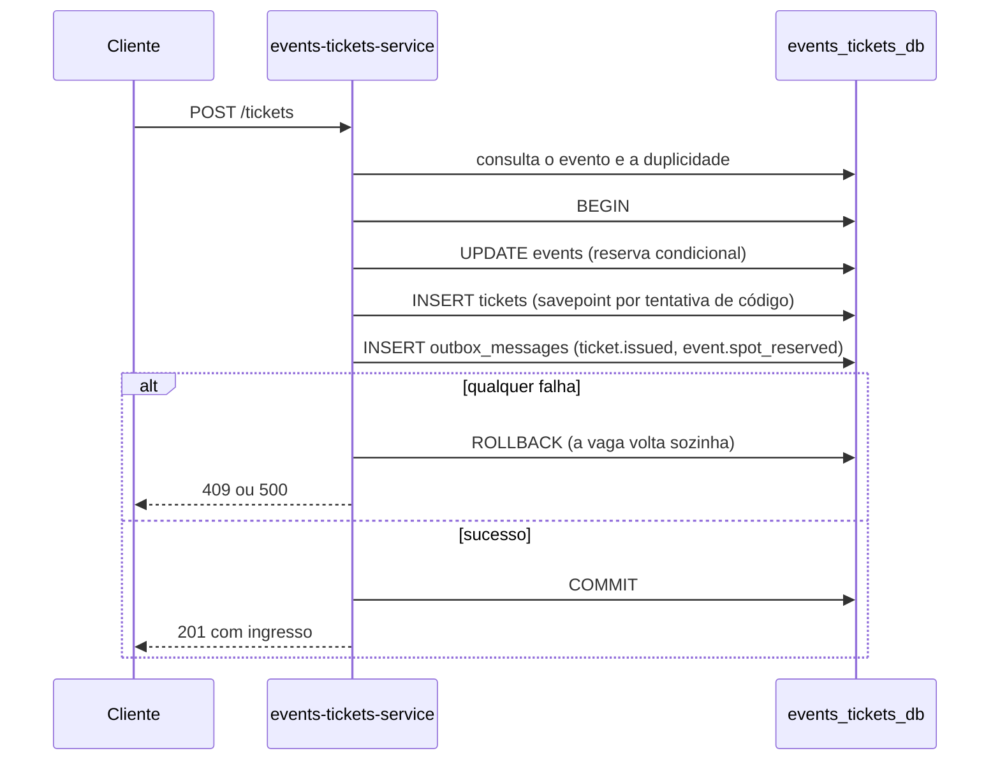
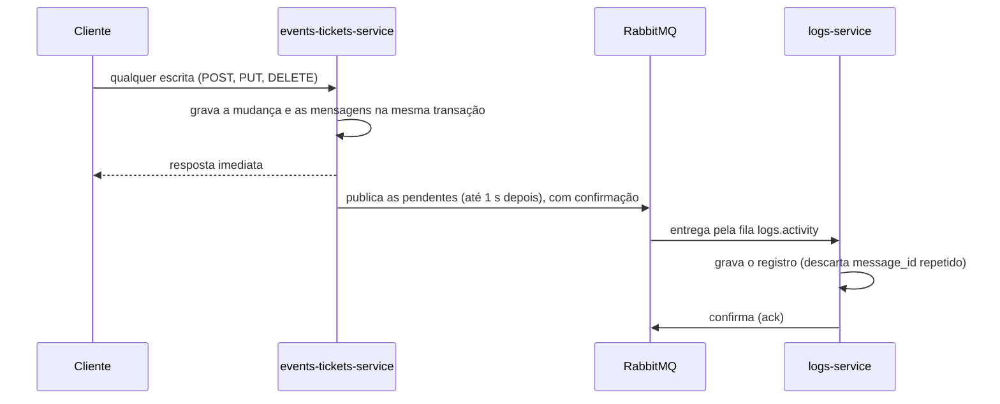
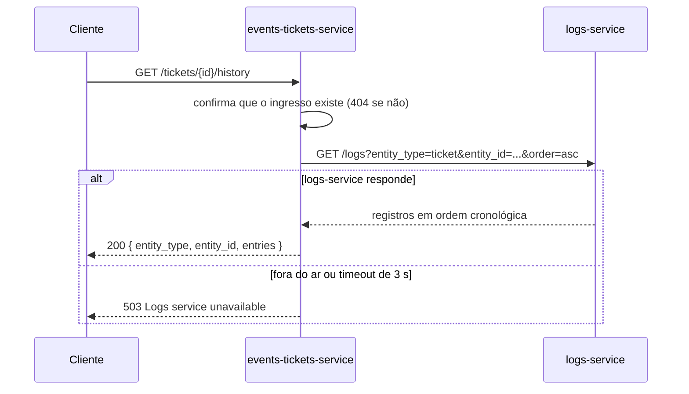

# Contratos da API

Regras de comportamento e erros dos dois serviços. Os campos das tabelas estão nas seções 5.1 e 5.2 do [prompt.md](prompt.md). As referências no formato D1, D2 etc. estão em [decisoes.md](decisoes.md).

Este documento deve continuar consistente com o Swagger em `/docs/events-tickets` e `/docs/logs`.

## API Gateway (porta 8080)

Único ponto de entrada externo (D13, D14). Rotas não listadas respondem `404 Route not found`, e um serviço indisponível responde `503 Service unavailable`.

| Rota pública | Destino |
|---|---|
| `/events`, `/events/{id}`, `/events/{id}/history` | `events-tickets-service` |
| `/tickets`, `/tickets/{id}`, `/tickets/{id}/history` | `events-tickets-service` |
| `/logs`, `/logs/{id}` | `logs-service` |
| `/docs/events-tickets`, `/docs/logs` | Swagger de cada serviço |
| `/health/events-tickets`, `/health/logs` | `GET /health` de cada serviço |
| `/metrics/events-tickets`, `/metrics/logs` | `GET /metrics` de cada serviço |
| `/prometheus/` | Interface do Prometheus |
| `/grafana/` | Painéis do Grafana |
| `/rabbitmq/` | Interface de gerenciamento do RabbitMQ |
| `/gateway/health` | Saúde do próprio gateway |
| `/app/` | Aplicação web: arquivos estáticos de `frontend/`, servidos pelo próprio gateway (D24) |
| `/` | Redireciona para `/app/` |

As rotas das tabelas abaixo são as de cada serviço.

## `events-tickets-service` (porta 3000)

Corpo, filtro ou UUID inválido responde `400` em todas as rotas (D12, D23).

### Eventos

| Método e rota | Sucesso | Erros |
|---|---|---|
| `POST /events` | `201` | `400` |
| `GET /events?category=&status=` | `200` | `400` |
| `GET /events/{id}` | `200` | `400`, `404` |
| `PUT /events/{id}` | `200` | `400`, `404`, `409` |
| `DELETE /events/{id}` | `204` | `400`, `404` |
| `GET /events/{id}/history` | `200` | `400`, `404`, `503` |

#### Regras de eventos

- `max_capacity > 0` e `end_at` posterior a `start_at`; senão, `400 end_at must be after start_at`.
- `start_at` e `end_at` exigem fuso horário (`2026-11-20T08:00:00-04:00` ou sufixo `Z`); sem fuso, a API responde `400` (D10).
- O `PUT` altera somente os campos enviados, e enviar `null` só é aceito em `description` e `metadata_info` (D10).
- Na criação, `available_spots = max_capacity` e `status = PUBLISHED`. O cliente não define `available_spots` diretamente.
- **Mudança de capacidade (D2):** `ocupadas = max_capacity - available_spots`. Com nova capacidade menor que `ocupadas`, responde `409`; caso contrário, `available_spots = nova capacidade - ocupadas`. O status alterna entre `PUBLISHED` e `SOLD_OUT` conforme as vagas livres. O `PUT` trava a linha com `SELECT ... FOR UPDATE`.
- **Evento cancelado (D17):** `CANCELLED` é um estado final; mudar para outro status responde `409 Cancelled event cannot be reopened`. Os demais campos continuam editáveis.
- **Cancelar ou remover evento (D22):** na mesma transação, todos os ingressos ativos passam para `CANCELLED`, sem devolver vagas. A resposta já reflete o cancelamento. Os ingressos mantêm o `event_snapshot`.

### Ingressos

| Método e rota | Sucesso | Erros |
|---|---|---|
| `POST /tickets` | `201` | `400`, `404`, `409`, `500` |
| `GET /tickets?event_id=&participant_email=&status=` | `200` | `400` |
| `GET /tickets/{id}` (UUID ou `ticket_code`) | `200` | `404` |
| `PUT /tickets/{id}` | `200` | `400`, `404`, `409` |
| `DELETE /tickets/{id}` | `200` | `400`, `404`, `409` |
| `GET /tickets/{id}/history` (UUID ou `ticket_code`) | `200` | `404`, `503` |
| `GET /health` · `GET /metrics` | `200` | `503` no `/health` sem banco |

#### Regras de ingressos

- `ticket_code` tem o formato `EVT-2026-XXXXXX` (6 caracteres alfanuméricos maiúsculos). Em caso de colisão, gera outro código, dentro de um savepoint da mesma transação.
- **Duplicidade (D3):** só um ingresso não cancelado por `(event_id, participant_document)`. Uma nova inscrição é aceita depois do cancelamento.
- **`PUT` (D5, D12):**
  - Altera somente os campos enviados; campos desconhecidos e `null` respondem `400`.
  - Aceita dados do participante, `modality_tier` e `status: CHECKED_IN`; enviar `event_id` responde `400`.
  - `CHECKED_IN` só a partir de `CONFIRMED`; outra origem responde `409`.
  - `status: CANCELLED` responde `400`, porque o cancelamento é feito por `DELETE`.
  - Ingresso `CANCELLED` não é editável (`409`).
  - Alterar o documento para um já ativo no evento responde `409`.
- **`DELETE` (D1):** vale para `CONFIRMED` e `CHECKED_IN`, devolve a vaga ao evento na mesma transação e responde com o ingresso `CANCELLED`. Repetir responde `409`.

<a id="fluxos-entre-servicos"></a>

## Fluxos

### Emissão: `POST /tickets`

Tudo acontece no `events-tickets-service`, em uma única transação do PostgreSQL (D18).



| Situação | Resposta |
|---|---|
| Evento inexistente | `404 Event not found` |
| Status `CANCELLED` ou `FINISHED` | `400 Event is not open for registrations` |
| Status `SOLD_OUT` ou sem vagas, na consulta ou na reserva (D11) | `409 Event is sold out` |
| Evento fechado entre a consulta e a reserva | `409 Event is not open for registrations` |
| Participante já inscrito, inclusive em inscrições simultâneas | `409 Participant already registered for this event` |
| Falha inesperada ao salvar | `500 Could not issue ticket`, sem consumir a vaga |

### Cancelamento: `DELETE /tickets/{id}`

Em uma única transação:

1. Atualiza para `CANCELLED` por `UPDATE` condicional (status ainda igual ao lido). Se nenhuma linha mudar, responde `409`, sem devolver vaga.
2. Devolve a vaga com `UPDATE` condicional (`available_spots < max_capacity`); um evento `SOLD_OUT` volta a `PUBLISHED`.
3. Grava `ticket.cancelled` e, se a vaga voltou, `event.spot_released`.

Se o evento não existir mais, o cancelamento vale do mesmo jeito, e o log registra `[TICKET CANCELLED WITHOUT EVENT]`.

### Registro de atividades: `events-tickets-service` → RabbitMQ → `logs-service` (D20)



| Item | Valor |
|---|---|
| Exchange | `events-tickets.exchange` (topic, durável) |
| Routing keys | `event.created`, `event.updated`, `event.cancelled`, `event.deleted`, `event.spot_reserved`, `event.spot_released`, `ticket.issued`, `ticket.updated`, `ticket.checked_in`, `ticket.cancelled` |
| Fila | `logs.activity` (durável), ligada a `event.*` e `ticket.*` |
| Fila de mensagens inválidas | `logs.activity.dlq` |

| Operação | Mensagens gravadas |
|---|---|
| `POST /events` | `event.created` |
| `PUT /events/{id}` | `event.updated`, ou `event.cancelled` + um `ticket.cancelled` por ingresso ativo |
| `DELETE /events/{id}` | `event.deleted` + um `ticket.cancelled` por ingresso ativo |
| `POST /tickets` | `ticket.issued` + `event.spot_reserved` |
| `PUT /tickets/{id}` | `ticket.checked_in` ou `ticket.updated` |
| `DELETE /tickets/{id}` | `ticket.cancelled` + `event.spot_released` |

```json
{
  "message_id": "5a1e7c2e-9a55-4b2f-8f35-2f1b7e8a4c10",
  "action": "ticket.issued",
  "entity_type": "ticket",
  "entity_id": "7c9e6679-7425-40de-944b-e07fc1f90ae7",
  "level": "INFO",
  "message": "Ticket EVT-2026-A8F9K2 issued",
  "data": {
    "ticket_code": "EVT-2026-A8F9K2",
    "event_id": "3fa85f64-5717-4562-b3fc-2c963f66afa6",
    "status": "CONFIRMED",
    "modality_tier": "ESTUDANTE"
  },
  "source": "events-tickets-service",
  "occurred_at": "2026-11-20T12:00:00.000Z",
  "correlation_id": "demo-123"
}
```

- `level` é `WARNING` em `event.cancelled`, `event.deleted` e `ticket.cancelled`, e `INFO` nas demais.
- `data` nunca contém nome, e-mail ou documento do participante. Em `ticket.updated`, leva só `changed_fields`.
- Mensagem inválida, ou com routing key diferente de `action`, vai para a DLQ. Falha do banco devolve a mensagem à fila depois de 5 s.

### Histórico: `events-tickets-service` → HTTP → `logs-service` (D21)



Registros arquivados não aparecem no histórico.

## `logs-service` (porta 8000)

Dados inválidos e campos não editáveis respondem `422`, padrão do FastAPI.

| Método e rota | Sucesso | Erros |
|---|---|---|
| `POST /logs` | `201` | `422` |
| `GET /logs?entity_type=&entity_id=&action=&level=&status=&source=&correlation_id=&include_archived=&order=&limit=&offset=` | `200` | `422` |
| `GET /logs/{id}` | `200` | `404`, `422` |
| `PUT /logs/{id}` | `200` | `404`, `409`, `422` |
| `DELETE /logs/{id}` | `200` | `404`, `409`, `422` |
| `GET /health` · `GET /metrics` | `200` | `503` no `/health` sem banco |

### Regras dos registros (D19)

- **`POST /logs`** cria um registro manual: `action` no formato `<entidade>.<verbo>` (ex.: `incident.reported`), `message` obrigatória, `level` (`INFO`, `WARNING`, `ERROR`; padrão `INFO`), `entity_type` e `entity_id` opcionais (o id exige o tipo), `data`, `correlation_id`, `occurred_at` com fuso (padrão: agora) e `notes`. `source` padrão é `manual`. O registro nasce com `status: NEW` e `message_id: null`.
- **`GET /logs`** exclui os arquivados, a menos que `include_archived=true`. Ordena por `occurred_at` (`order=desc` por padrão; `asc` é a cronológica). `limit` vai de 1 a 500 (padrão 100), com `offset`.
- **`GET /logs/{id}`** devolve o registro mesmo arquivado, com `archived_at` preenchido.
- **`PUT /logs/{id}`** altera só `status` (`NEW`, `REVIEWED`, `RESOLVED`) e `notes` (aceita `null`). Qualquer outro campo, ou `status: null`, responde `422`. Registro arquivado responde `409 Archived log entry cannot be modified`.
- **`DELETE /logs/{id}`** arquiva: preenche `archived_at` e responde `200` com o registro. Repetir responde `409 Log entry is already archived`.

## Limitações conhecidas

- **Histórico eventualmente consistente:** um registro aparece no histórico cerca de 1 s depois da operação, o tempo de a outbox publicar e o `logs-service` consumir. Com o broker ou o `logs-service` fora do ar, o atraso dura até eles voltarem; nada se perde.
- **Ordem entre registros do mesmo milissegundo:** atividades gravadas na mesma transação para entidades diferentes (por exemplo, `ticket.issued` e `event.spot_reserved`) podem ter o mesmo `occurred_at`. O histórico de uma entidade não é afetado.
- **Sem autenticação:** qualquer cliente pode criar, editar a triagem e arquivar registros.
