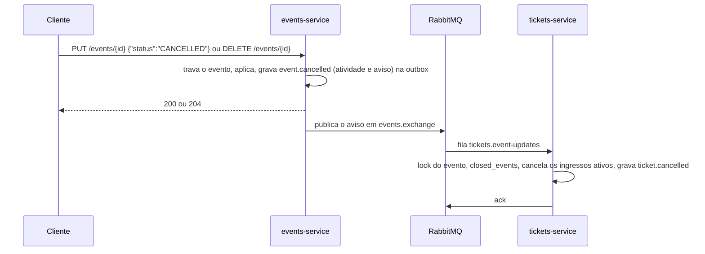
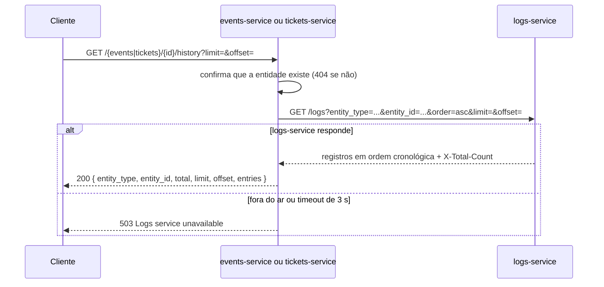

# Contratos da API

Regras de comportamento e erros dos três serviços. Os campos das tabelas estão na seção 5 do [prompt.md](prompt.md). As referências no formato D1, D2 etc. estão em [decisoes.md](decisoes.md).

Este documento deve continuar consistente com o Swagger em `/docs/events`, `/docs/tickets` e `/docs/logs`.

## API Gateway (porta 8080)

Único ponto de entrada externo (D13, D14). Rotas não listadas respondem `404 Route not found`, e um serviço indisponível responde `503 Service unavailable`.

| Rota pública | Destino |
|---|---|
| `/events`, `/events/{id}`, `/events/{id}/history` | `events-service` |
| `/tickets`, `/tickets/{id}`, `/tickets/{id}/history` | `tickets-service` |
| `/logs`, `/logs/{id}` | `logs-service` |
| `/docs/events`, `/docs/tickets`, `/docs/logs` | Swagger de cada serviço |
| `/health/events`, `/health/tickets`, `/health/logs` | `GET /health` de cada serviço |
| `/metrics/events`, `/metrics/tickets`, `/metrics/logs` | `GET /metrics` de cada serviço |
| `/prometheus/` | Interface do Prometheus |
| `/grafana/` | Painéis do Grafana |
| `/rabbitmq/` | Interface de gerenciamento do RabbitMQ |
| `/gateway/health` | Saúde do próprio gateway |
| `/app/` | Aplicação web: arquivos estáticos de `frontend/`, servidos pelo próprio gateway (D24) |
| `/` | Redireciona para `/app/` |

A rota interna `PATCH /events/{id}/reserve-spot` fica fora da lista: só o `tickets-service` a chama, pela rede interna (D30).

As rotas das tabelas abaixo são as de cada serviço.

## Paginação (D26)

Vale nos três serviços.

| Rota | `limit` | `offset` | Total |
|---|---|---|---|
| `GET /events`, `GET /tickets`, `GET /logs` | 1 a 500, padrão 100 | ≥ 0, padrão 0 | Cabeçalho `X-Total-Count` |
| `GET /events/{id}/history`, `GET /tickets/{id}/history` | 1 a 500, padrão 500 | ≥ 0, padrão 0 | Campo `total` da resposta |

- `GET /events` e `GET /tickets` vêm dos mais recentes aos mais antigos (`created_at` decrescente, com o `id` como desempate). O corpo continua sendo uma lista.
- `X-Total-Count` é o total que atende aos filtros, sem considerar `limit` e `offset`. Há mais páginas se `offset` + itens recebidos for menor que o total.

## `events-service` (porta 3001)

Corpo, filtro, paginação ou UUID inválido responde `400` em todas as rotas (D12, D23, D35).

| Método e rota | Sucesso | Erros |
|---|---|---|
| `POST /events` | `201` | `400` |
| `GET /events?category=&status=&limit=&offset=` | `200` | `400` |
| `GET /events/{id}` | `200` | `400`, `404` |
| `PUT /events/{id}` | `200` | `400`, `404`, `409` |
| `DELETE /events/{id}` | `204` | `400`, `404` |
| `GET /events/{id}/history?limit=&offset=` | `200` | `400`, `404`, `503` |
| `PATCH /events/{id}/reserve-spot` (interna) | `200` | `400`, `404`, `409` |
| `GET /health` · `GET /metrics` | `200` | `503` no `/health` sem banco |

### Regras de eventos

- `max_capacity > 0` e `end_at` posterior a `start_at`; senão, `400 end_at must be after start_at`.
- `start_at` e `end_at` exigem fuso horário (`2026-11-20T08:00:00-04:00` ou sufixo `Z`); sem fuso, a API responde `400` (D10).
- O `PUT` altera somente os campos enviados, e enviar `null` só é aceito em `description` e `metadata_info` (D10).
- Na criação, `available_spots = max_capacity` e `status = PUBLISHED`. O cliente não define `available_spots` diretamente.
- **Mudança de capacidade (D2):** `ocupadas = max_capacity - available_spots`. Com nova capacidade menor que `ocupadas`, responde `409`; caso contrário, `available_spots = nova capacidade - ocupadas`. O status alterna entre `PUBLISHED` e `SOLD_OUT` conforme as vagas livres. O `PUT` trava a linha com `SELECT ... FOR UPDATE`.
- **Evento cancelado (D17):** `CANCELLED` é um estado final; mudar para outro status responde `409 Cancelled event cannot be reopened`. Os demais campos continuam editáveis.
- **Cancelar ou remover evento (D33):** a resposta sai na hora, e o aviso ao `tickets-service` vai pela outbox. Os ingressos ativos passam para `CANCELLED` cerca de 1 s depois, sem devolver vagas, e mantêm o `event_snapshot`.

### Reserva de vaga: `PATCH /events/{id}/reserve-spot` (D30)

Rota interna, chamada pelo `tickets-service` com `{ "ticket_id": "<uuid>" }`. Em uma transação do `events-db`, confere o evento, reserva com `UPDATE` condicional (`status = 'PUBLISHED' AND available_spots > 0 AND end_at > now()`, mudando para `SOLD_OUT` ao zerar), grava a reserva em `spot_reservations` e grava `event.spot_reserved` na outbox. Responde o evento já atualizado.

| Situação | Resposta |
|---|---|
| Reserva feita | `200` com o evento |
| Mesmo `ticket_id` de uma reserva ativa, inclusive em chamadas simultâneas | `200` com o evento, sem reservar outra vaga |
| Evento inexistente, inclusive se removido entre a consulta e a reserva | `404 Event not found` |
| Evento já encerrado (`end_at` no passado), qualquer que seja o status (D25) | `400 Event has already ended` |
| Status `CANCELLED` ou `FINISHED` | `400 Event is not open for registrations` |
| Status `SOLD_OUT` ou sem vagas, na consulta ou na reserva (D11) | `409 Event is sold out` |
| Evento encerrado entre a consulta e a reserva | `409 Event has already ended` |
| Evento fechado entre a consulta e a reserva | `409 Event is not open for registrations` |
| A vaga deste `ticket_id` já foi devolvida (D31) | `409 Reservation for this ticket was already released` |
| `ticket_id` já reservado em outro evento | `409 Reservation for this ticket belongs to another event` |

## `tickets-service` (porta 3002)

Corpo, filtro, paginação ou UUID inválido responde `400` em todas as rotas (D12, D23).

| Método e rota | Sucesso | Erros |
|---|---|---|
| `POST /tickets` | `201` | `400`, `404`, `409`, `500`, `503` |
| `GET /tickets?event_id=&participant_email=&status=&limit=&offset=` | `200` | `400` |
| `GET /tickets/{id}` (UUID ou `ticket_code`) | `200` | `404` |
| `PUT /tickets/{id}` | `200` | `400`, `404`, `409` |
| `DELETE /tickets/{id}` | `200` | `400`, `404`, `409` |
| `GET /tickets/{id}/history?limit=&offset=` (UUID ou `ticket_code`) | `200` | `400`, `404`, `503` |
| `GET /health` · `GET /metrics` | `200` | `503` no `/health` sem banco |

### Regras de ingressos

- O `id` do ingresso é gerado pelo `tickets-service` antes da reserva e é a chave da reserva no `events-service` (D30).
- `ticket_code` tem o formato `EVT-2026-XXXXXX` (6 caracteres alfanuméricos maiúsculos). Em caso de colisão, gera outro código, dentro de um savepoint da mesma transação.
- **Evento aberto (D25):** a inscrição exige um evento que existe, está `PUBLISHED`, tem vaga e ainda não terminou (`end_at` no futuro). Vale o fim, e não o início: um evento em andamento aceita inscrições.
- **Duplicidade (D3):** só um ingresso não cancelado por `(event_id, participant_document)`. Uma nova inscrição é aceita depois do cancelamento.
- **`PUT` (D5, D12):**
  - Altera somente os campos enviados; campos desconhecidos e `null` respondem `400`.
  - Aceita dados do participante, `modality_tier` e `status: CHECKED_IN`; enviar `event_id` responde `400`.
  - `CHECKED_IN` só a partir de `CONFIRMED`; outra origem responde `409`.
  - `status: CANCELLED` responde `400`, porque o cancelamento é feito por `DELETE`.
  - Ingresso `CANCELLED` não é editável (`409`).
  - Alterar o documento para um já ativo no evento responde `409`.
- **`DELETE` (D1, D31):** vale para `CONFIRMED` e `CHECKED_IN`, responde com o ingresso `CANCELLED` e pede a devolução da vaga pelo RabbitMQ; a vaga volta ao evento cerca de 1 s depois. Repetir responde `409`.

<a id="fluxos-entre-servicos"></a>

## Fluxos entre os serviços

### Emissão: `POST /tickets` (D30)

```mermaid
sequenceDiagram
    participant C as Cliente
    participant T as tickets-service
    participant TD as tickets_db
    participant E as events-service
    participant ED as events_db
    C->>T: POST /tickets
    T->>TD: evento em closed_events? participante já inscrito?
    T->>T: gera o id do ingresso
    T->>E: PATCH /events/{id}/reserve-spot { ticket_id }
    E->>ED: BEGIN; UPDATE events (reserva condicional) RETURNING *
    E->>ED: INSERT spot_reservations; INSERT outbox (event.spot_reserved); COMMIT
    alt recusa (404, 400, 409)
        E-->>T: erro
        T-->>C: mesmo código e mensagem
    else sem resposta definitiva (timeout, 5xx, fora do ar)
        T->>TD: INSERT outbox (spot.release_requested: issue_failed)
        T-->>C: 503 Events service unavailable
    else reservada
        E-->>T: 200 evento
        T->>TD: BEGIN; lock do evento; INSERT tickets; INSERT outbox (ticket.issued); COMMIT
        alt falha ao salvar
            T->>TD: INSERT outbox (spot.release_requested: issue_failed)
            T-->>C: 409 ou 500
        else sucesso
            T-->>C: 201 com ingresso
        end
    end
```

| Situação | Resposta |
|---|---|
| Evento já registrado em `closed_events` (cancelado ou removido) (D32) | `400 Event is not open for registrations`, sem chamar o `events-service` |
| Participante já inscrito, inclusive em inscrições simultâneas | `409 Participant already registered for this event` |
| Evento inexistente | `404 Event not found` |
| Evento já encerrado, `CANCELLED`, `FINISHED`, esgotado ou fechado durante a reserva | O código e a mensagem do `events-service` (tabela da reserva) |
| `events-service` sem resposta definitiva | `503 Events service unavailable`, e a devolução é pedida |
| Evento cancelado ou removido entre a reserva e o salvamento (D32) | `409 Event is not open for registrations`, e a vaga é devolvida |
| Falha inesperada ao salvar | `500 Could not issue ticket`, e a vaga é devolvida |

### Cancelamento: `DELETE /tickets/{id}` (D31)

Em uma transação do `tickets-db`:

1. Atualiza para `CANCELLED` por `UPDATE` condicional (status ainda igual ao lido). Se nenhuma linha mudar, responde `409`, sem pedir devolução.
2. Grava `ticket.cancelled` e o pedido `spot.release_requested` (`reason: ticket_cancelled`) na outbox.

O `events-service` consome o pedido e, em uma transação, trava a reserva do `ticket_id`, marca `RELEASED`, devolve a vaga com `UPDATE` condicional (`available_spots < max_capacity`; `SOLD_OUT` volta a `PUBLISHED`) e grava `event.spot_released`. Pedido repetido não muda nada. Pedido sem reserva grava a linha já `RELEASED`, para recusar uma reserva atrasada do mesmo ingresso. Se o evento não existir mais, a reserva fica `RELEASED`, e o log registra `[EVENT SPOT RELEASE IGNORED]` com `event_missing`.

### Cancelamento ou remoção de evento (D33)



### Mensagens (D20, D34)

| Exchange (topic) | Publicada por | Routing keys | Fila (consumidor) | DLQ |
|---|---|---|---|---|
| `activities.exchange` | `events-service`, `tickets-service` | atividades `event.*` e `ticket.*` | `logs.activity` (`logs-service`) | `logs.activity.dlq` |
| `events.exchange` | `events-service` | `event.cancelled`, `event.deleted` | `tickets.event-updates` (`tickets-service`) | `tickets.event-updates.dlq` |
| `tickets.exchange` | `tickets-service` | `spot.release_requested` | `events.spot-releases` (`events-service`) | `events.spot-releases.dlq` |

| Operação | Mensagens gravadas |
|---|---|
| `POST /events` | `event.created` (atividade) |
| `PUT /events/{id}` | `event.updated`, ou `event.cancelled` (atividade e aviso ao `tickets-service`) |
| `DELETE /events/{id}` | `event.deleted` (atividade e aviso ao `tickets-service`) |
| Reserva de vaga | `event.spot_reserved` (atividade, no `events-service`) |
| `POST /tickets` | `ticket.issued` (atividade); `spot.release_requested` se a emissão falhar depois da reserva |
| `PUT /tickets/{id}` | `ticket.checked_in` ou `ticket.updated` (atividade) |
| `DELETE /tickets/{id}` | `ticket.cancelled` (atividade) e `spot.release_requested` |
| Devolução consumida pelo `events-service` | `event.spot_released` (atividade) |
| Aviso de evento cancelado ou removido, consumido pelo `tickets-service` | um `ticket.cancelled` por ingresso ativo (atividade) |

**Atividade** (`activities.exchange`):

```json
{
  "message_id": "5a1e7c2e-9a55-4b2f-8f35-2f1b7e8a4c10",
  "action": "ticket.issued",
  "entity_type": "ticket",
  "entity_id": "7c9e6679-7425-40de-944b-e07fc1f90ae7",
  "level": "INFO",
  "message": "Ticket EVT-2026-A8F9K2 issued",
  "data": {
    "ticket_code": "EVT-2026-A8F9K2",
    "event_id": "3fa85f64-5717-4562-b3fc-2c963f66afa6",
    "status": "CONFIRMED",
    "modality_tier": "ESTUDANTE"
  },
  "source": "tickets-service",
  "occurred_at": "2026-11-20T12:00:00.000Z",
  "correlation_id": "demo-123"
}
```

**Aviso de evento encerrado** (`events.exchange`, routing key igual a `type`):

```json
{
  "message_id": "0b6f3d0e-6a4e-4d8a-9f43-3a7c3c1b9e21",
  "type": "event.cancelled",
  "event_id": "3fa85f64-5717-4562-b3fc-2c963f66afa6",
  "source": "events-service",
  "occurred_at": "2026-11-20T12:00:00.000Z",
  "correlation_id": "demo-123"
}
```

**Pedido de devolução** (`tickets.exchange`, routing key `spot.release_requested`):

```json
{
  "message_id": "c7a2f1b4-2d6e-4f0a-8b5c-1e9d3a7f6b20",
  "type": "spot.release_requested",
  "event_id": "3fa85f64-5717-4562-b3fc-2c963f66afa6",
  "ticket_id": "7c9e6679-7425-40de-944b-e07fc1f90ae7",
  "reason": "ticket_cancelled",
  "source": "tickets-service",
  "occurred_at": "2026-11-20T12:00:00.000Z",
  "correlation_id": "demo-123"
}
```

- `level` é `WARNING` em `event.cancelled`, `event.deleted` e `ticket.cancelled`, e `INFO` nas demais atividades.
- Nenhuma mensagem contém nome, e-mail ou documento do participante. Em `ticket.updated`, `data` leva só `changed_fields`.
- `reason` do pedido de devolução: `ticket_cancelled` (cancelamento) ou `issue_failed` (compensação). `reason` do `ticket.cancelled`: `requested`, `event_cancelled` ou `event_deleted`.
- Todo consumidor confirma (`ack`) só depois de gravar. Mensagem inválida, ou com routing key diferente de `action`/`type`, vai para a DLQ; falha do banco devolve a mensagem à fila depois de 5 s.
- Os publicadores conectam ao broker antes de abrir a transação, leem até 50 mensagens por vez e, se o lote vier cheio, buscam o próximo em seguida (D28). Mensagem devolvida por falta de fila continua pendente sozinha (D34). Com o broker fora do ar, tentam de novo a cada 5 s.

### Histórico: serviço → HTTP → `logs-service` (D21)



Registros arquivados não aparecem no histórico. A página padrão tem 500 registros, o máximo do `GET /logs`; se `offset` + `entries.length` for menor que `total`, peça a página seguinte com `offset` (D26). `total` é `null` se o `logs-service` não informar o `X-Total-Count`.

## `logs-service` (porta 8000)

Dados inválidos e campos não editáveis respondem `422`, padrão do FastAPI.

| Método e rota | Sucesso | Erros |
|---|---|---|
| `POST /logs` | `201` | `422` |
| `GET /logs?entity_type=&entity_id=&action=&level=&status=&source=&correlation_id=&include_archived=&order=&limit=&offset=` | `200` | `422` |
| `GET /logs/{id}` | `200` | `404`, `422` |
| `PUT /logs/{id}` | `200` | `404`, `409`, `422` |
| `DELETE /logs/{id}` | `200` | `404`, `409`, `422` |
| `GET /health` · `GET /metrics` | `200` | `503` no `/health` sem banco |

### Regras dos registros (D19)

- **`POST /logs`** cria um registro manual: `action` no formato `<entidade>.<verbo>` (ex.: `incident.reported`), `message` obrigatória, `level` (`INFO`, `WARNING`, `ERROR`; padrão `INFO`), `entity_type` e `entity_id` opcionais (o id exige o tipo), `data`, `correlation_id`, `occurred_at` com fuso (padrão: agora) e `notes`. `source` padrão é `manual`. O registro nasce com `status: NEW` e `message_id: null`.
- **`GET /logs`** exclui os arquivados, a menos que `include_archived=true`. Ordena por `occurred_at` (`order=desc` por padrão; `asc` é a cronológica). `limit` vai de 1 a 500 (padrão 100), com `offset`, e o cabeçalho `X-Total-Count` traz o total que atende aos filtros (D26).
- **`GET /logs/{id}`** devolve o registro mesmo arquivado, com `archived_at` preenchido.
- **`PUT /logs/{id}`** altera só `status` (`NEW`, `REVIEWED`, `RESOLVED`) e `notes` (aceita `null`). Qualquer outro campo, ou `status: null`, responde `422`. Registro arquivado responde `409 Archived log entry cannot be modified`.
- **`DELETE /logs/{id}`** arquiva: preenche `archived_at` e responde `200` com o registro. Repetir responde `409 Log entry is already archived`.

## Limitações conhecidas

- **Consistência eventual entre os serviços:** a vaga de um ingresso cancelado volta ao evento, e os ingressos de um evento cancelado são cancelados, cerca de 1 s depois da resposta. Com o broker ou o serviço consumidor fora do ar, o atraso dura até eles voltarem; nada se perde (D31, D33).
- **Histórico eventualmente consistente:** um registro aparece no histórico cerca de 1 s depois da operação, o tempo de a outbox publicar e o `logs-service` consumir.
- **Vaga presa em falha dupla:** se o `tickets-db` cair entre a reserva e o salvamento do ingresso, nem a compensação pode ser gravada, e a vaga fica reservada; o log `[COMPENSATION FAILED]` traz o `ticket_id` (D30).
- **Ordem entre registros do mesmo milissegundo:** atividades gravadas para entidades diferentes podem ter o mesmo `occurred_at`. O histórico de uma entidade não é afetado.
- **Sem autenticação:** qualquer cliente pode criar, editar a triagem e arquivar registros. A rota interna de reserva só é protegida por estar fora do gateway.
